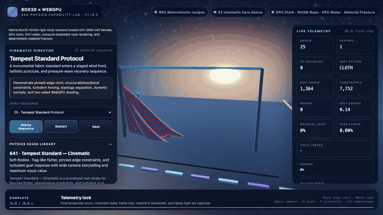
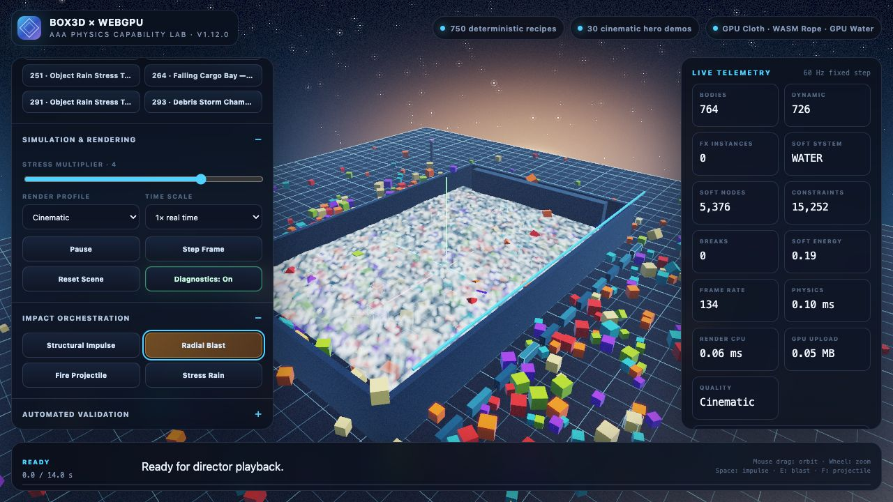
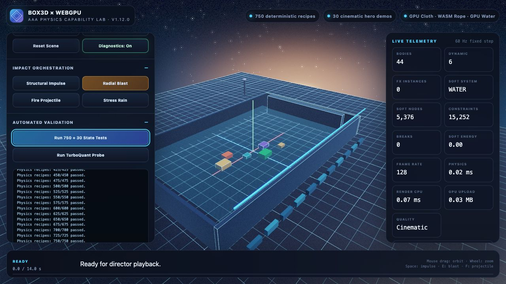

# Box3D WebGPU — AAA Physics Lab

A browser-native 3D physics showcase combining **Box3D rigid bodies**, deterministic **cloth and rope**, interactive **shallow water**, comparative **material bending and fracture**, and an HDR **WebGPU** renderer.

The current tree preserves the **800 deterministic capability-scene catalog** and expands the director from 34 to **65 hero demonstrations**. Thirty-one new recipe-driven material programs add ten metal-forming tests, ten architectural-glass fracture tests, ten reinforced-concrete failure tests, and the combined **Apex Materials Proving Ground**. The ten-scene signature set and its exactly **100 runtime-authored AAA improvements** remain unchanged. The material-realism pass keeps the authoritative simulations intact while replacing exposed solver grids with curvature-following skins, giving cold-formed metal restrained coating flakes and procedural environment reflections, separating glass into a two-sided blended Fresnel pass, and rendering concrete dust as translucent media around physical aggregate, spall, and persistent reinforcement. Native Box3D WebAssembly artifacts, SIMD/scalar soft-system kernels, Poliigon-derived GPU material atlases, and the source-frozen v1.13 1,000-case optimization audit remain included.

> This is an AAA-style capability lab and engine foundation. It is not a claim that the numerical Box3D solver runs on WebGPU or that every subsystem of a commercial game engine is complete.

## At a glance

- Native Box3D C17 physics compiled to WebAssembly with Emscripten.
- Deterministic PBD cloth and rope plus a 2.5D shallow-water solver.
- Deterministic elastic, plastic, fatigue, and fracture comparisons across ten normalized material presets.
- Perimeter-clamped metal pressure panels with an actuator that engages and retracts, two-axis bending, localized dent strikes, springback, and residual-set telemetry.
- Material-specific impact effects: restrained cold-forming flash/coating flakes, translucent concrete dust with aggregate and rebar contact, and a vertical glass fracture wave with sparse edge glints.
- Dense damage-aware sheet/cover tiles whose orthonormal bases follow metal, concrete, and glass curvature while failed regions open locally.
- Concrete cover fragments emitted by cohesive-cell failure, with ductile rebar constraints continuing to bridge the damaged slab.
- Framed vertical glass with a dedicated blended Fresnel pass, deterministic radial crack fronts, restrained branch glints, and thin tumbling transparent shards.
- SIMD WebAssembly, scalar WebAssembly, and JavaScript fallback paths.
- GPU-resident presentation for intact cloth and water.
- WebGPU compute expansion of compact rope data.
- HDR rendering, real quality profiles, shadows, PBR-inspired materials, atmospheric effects, and post-processing.
- Poliigon-derived concrete, galvanized metal, woven fabric, and honed-stone materials in directly uploadable KTX2 atlases.
- Reflective architectural glass plus progressive concrete fracture, physical spall, and exposed reinforcement dressing.
- 800 searchable scenes across 16 simulation families.
- 65 directed cinematic demonstrations: 34 established heroes plus 31 recipe-driven material programs.
- Exactly ten new metal, ten new glass, ten new concrete, and one combined proving-ground sequence.
- Ten starred signature scenes remain the curated cross-domain set.
- Exactly 100 numbered, runtime-validated AAA stage improvements—ten for every signature scene.
- Deterministic replay hashes, runtime telemetry, and in-app state tests.
- KTX2 ASTC material atlases with RGBA8 fallback, plus BC4 micro-noise with R8 fallback.
- Optional TurboQuant transport for remote snapshots and replay storage.
- Exact source manifest and reproducible benchmark/validation commands.

## Demo gallery

The retained recording below captures the v1.14 Maximum AAA Tour running through a real Chrome/WebGPU compositor with native Box3D WebAssembly and SIMD soft-system kernels. Versions 1.15–1.19 retain that live proof while adding the material-atlas pass, instrumented metal forming, concrete spall/rebar transfer, glass shattering, material-specific strike VFX, dedicated inspection cameras, and the 100-item signature-stage production pass. The new 31-program material expansion is not represented as though it were present in that historical recording. The two-minute cut plays at 2× speed from four minutes of live application capture and concentrates on the five highest-value simulation domains: cloth, water, tower destruction, bridge infrastructure, and rope rigging. The static images that follow are retained v1.12 hardware-browser acceptance captures.

### Demo video

[](docs/media/box3d-webgpu-demo.mp4)

Click the animated preview to open the [two-minute H.264 demo recording](docs/media/box3d-webgpu-demo.mp4) at 1280×720 and 30 fps. It is a silent 2× presentation of four minutes of live WebGPU output—not a slideshow or generated substitute—with scene state, body counts, frame timing, camera direction, effects, and timeline telemetry changing in real time. Each of the ten directed showcases appears exactly once; the edit does not restart or replay a demo.

| Chapter | Time | Directed hero demonstrations |
|---|---:|---|
| **Cloth** | 0:00–0:24 | Tempest Standard Protocol · Parachute Canopy Failure |
| **Interactive water** | 0:24–0:48 | Tsunami Research Array · Leviathan Impact Basin |
| **Tower destruction** | 0:48–1:12 | Aegis Tower: Kinetic Breach · Twin Spire Progressive Collapse |
| **Bridge infrastructure** | 1:12–1:36 | Truss Span Failure · Viaduct Shockwave |
| **Rope and rigging** | 1:36–2:00 | Sky Crane Cable Failure · Suspension Cable Resonance |

<table>
  <tr>
    <td width="50%">
      
      <br><strong>Water + rigid-body stress</strong><br>
      GPU-resident shallow water, hundreds of active bodies, cinematic rendering, and live frame telemetry.
    </td>
    <td width="50%">
      
      <br><strong>Deterministic state validation</strong><br>
      The in-app browser suite exercises the complete recipe catalog while reporting backend, timing, upload, and replay state.
    </td>
  </tr>
</table>



The capture and acceptance workflow is documented in [LOCAL_BROWSER_VALIDATION.md](docs/LOCAL_BROWSER_VALIDATION.md), with the directed presentation order in [DEMO_GUIDE.md](docs/DEMO_GUIDE.md).

## Architecture

```text
Box3D C17 / WebAssembly            Soft-system coordinator
rigid bodies and collisions        cloth PBD · rope PBD · shallow water · fracture lattice
             │                     SIMD WASM · scalar WASM · JS fallback
             └──────────────┬───────────────────────────────┘
                            │ fixed 60 Hz coordination
                            ▼
              solver-native state + compact streams
                            │
                            ▼
 WebGPU cloth/water reconstruction · rope/material compute expansion · rigid instancing
                            │
                            ▼
          shadows · HDR/MSAA · atmosphere · effects · post-processing
```

Box3D remains authoritative for rigid bodies. Cloth, rope, and water numerical solvers run on the CPU through JavaScript or WebAssembly. The comparative material-failure lattice is deterministic TypeScript. WebGPU handles rendering, intact-surface reconstruction, rope/material presentation expansion, and GPU resource work.

## Quick start

Requirements:

- Node.js `^20.19.0` or `>=22.12.0`; CI uses Node 22.
- A current desktop browser with WebGPU support.
- `localhost` or HTTPS. Opening `index.html` directly is not supported.

```bash
npm ci
npm run verify:source
npm run doctor
npm run dev
```

Open the local URL printed by Vite. The release includes the native Box3D browser artifacts in `public/box3d/`; if they cannot load, the app falls back to the deterministic JavaScript preview backend.

Run commands from the repository root—the directory containing `package.json`. Do not run them from `third_party/box3d`, which is the upstream C/CMake dependency.

## Ten signature AAA scenes

Starred entries in the hero selector are the curated signature set. Version 1.19 adds exactly ten runtime-authored upgrades to each of these ten stages; ordinary catalog scenes receive none of this extra instance work and keep the established performance envelope.

| Stop | Showcase | New authored detail | Physics focus |
|---:|---|---|---|
| 1 | **Aegis Tower: Kinetic Breach** | concrete podium, reflective curtain wall, galvanized mullions | high-rise impact and progressive load-path loss |
| 2 | **Twin Spire Progressive Collapse** | twin glazed facades and metal framing around the skybridge | coupled tower collapse |
| 3 | **Truss Span Failure** | honed-stone deck, concrete piers, repeated galvanized braces | concentrated bridge load and brace loss |
| 4 | **Citadel Siege** | physical concrete spall, exposed rebar bands, impact rubble | breach, blast, and progressive wall failure |
| 5 | **Mega Atrium Collapse** | curved glass facade, metal caps, stone floor, concrete roof | architectural destruction at wide scale |
| 6 | **Tempest Standard Protocol** | Poliigon-derived woven-fabric response and detailed metal stage | cloth wind, impact, and tearing |
| 7 | **Sky Crane Cable Failure** | concrete footings, honed-stone deck, galvanized gantry | cable tension, payload inertia, and severing |
| 8 | **Tsunami Research Array** | concrete flume and glass/metal observation wall | waves, reflection, foam, and currents |
| 9 | **Concrete Spall & Rebar Exposure** | curvature-following cover, persistent ductile rebar cage, physical spall, exposed aggregate, translucent dust, and restrained contact sparks | localized cracking, cover loss, load transfer, and residual bridging |
| 10 | **Glass Catastrophic Fracture** | blended two-sided pane, fine disappearing crack tiles, radial branch glints, vertical fracture wave, and transparent persistent shards | flaw nucleation, bounded brittle propagation, and forensic fracture inspection |

Use **Cinematic** quality for normal presentation and **Ultra** only when the GPU has headroom. `F`, `E`, `Space`, `I`, slow motion, and material load controls expose the authored failure beats. Finish by opening **Automated Validation** and running the **800 + 65 State Tests**. See [AAA_SIGNATURE_SCENES.md](docs/AAA_SIGNATURE_SCENES.md) for the unchanged ten-scene signature contract and [AAA_SHOWCASE.md](docs/AAA_SHOWCASE.md) for all 65 director entries.

### The v1.19 100-improvement production pass

Every signature stage receives a distinct ten-item kit instead of a generic prop scatter. Tower scenes gain structural podiums, buttresses, crowns, warning systems, breach targets, and containment hardware. The bridge gains bearings, approach slabs, portals, redundancy chords, expansion joints, inspection lamps, and lane guidance. Cloth, rope, and water stages gain measurement equipment and operating infrastructure. Concrete and glass labs gain load hardware, shields, catch trays, forensic scales, datum rails, and controlled lighting.

The release contract is executable:

- `AAA_IMPROVEMENTS` must contain exactly 100 unique numbered records.
- Each of the ten signature scene IDs must own exactly ten records.
- Every record must produce at least one finite, positive-scale runtime primitive.
- Props are staged only for the active signature scene and use the existing cached instanced render/shadow stream.
- Native Box3D WASM and deterministic preview backends see the same presentation layer; the additions never create contacts, forces, or replay-hash changes.
- Static stage identity is reserved ahead of transient particles, so explosions cannot evict the authored environment from the quality budget.

The complete numbered ledger is [AAA_100_IMPROVEMENTS.md](docs/AAA_100_IMPROVEMENTS.md).

### Runtime path and fallback behavior

The application degrades by capability instead of refusing to start:

| Layer | Preferred path | Fallback | Visible signal |
|---|---|---|---|
| Rigid physics | native Box3D C17 WebAssembly | deterministic TypeScript preview | backend badge |
| Cloth, rope, water kernels | SIMD WebAssembly | scalar WebAssembly, then JavaScript | soft-kernel telemetry |
| Material failure | deterministic TypeScript beam lattice | same deterministic path | material telemetry panel |
| Rendering | WebGPU HDR frame graph | no non-WebGPU renderer | startup diagnostics |
| Material-noise texture | KTX2 BC4 | KTX2 R8, then procedural R8 | renderer diagnostics |
| AAA material atlas | KTX2 ASTC 6×6 | KTX2 RGBA8, then deterministic procedural atlas | renderer diagnostics |
| Remote state | raw full-precision streams | optional TurboQuant transport | TurboQuant probe |

`Deterministic Preview` means only the rigid-body backend has fallen back. Cloth, rope, water, and material specimens remain active. A WebGPU initialization failure is terminal because this project intentionally exercises WebGPU rather than hiding errors behind a WebGL renderer.

## What you can simulate

### Rigid bodies

- Box3D collisions, gravity, settling, continuous collision, impacts, and sleeping.
- Fixed 60 Hz stepping with four solver substeps by default.
- Stacks, domino chains, towers, bridges, vehicles, construction sites, warehouses, and demolition scenes.
- Structural impulses, radial explosions, projectiles, and object rain.
- Up to 4,096 staged rigid bodies with compact transform/material streams.
- Deterministic preview broadphase using coherent sweep-and-prune.

### Cloth

- Verlet-style position-based dynamics with structural, shear, and bend constraints.
- Banners, curtains, canopies, hammocks, sails, cargo nets, and tensioned membranes.
- Pin layouts, wind, turbulence, gravity, ground and sphere collision, impacts, and blast response.
- Strain visualization and real topology-aware tearing.
- Adaptive intact-cloth projection schedules qualified against a 0.2% fidelity ceiling.
- Twelve dynamic bytes per intact vertex; rest positions and topology remain static on the GPU.
- WebGPU reconstructs normals, UVs, strain, material color, woven response, and shadow position.
- Tearing cloth uses the topology-aware packed CPU path so holes and disconnected triangles remain correct.

### Rope and rigging

- PBD chains with distance and bend constraints.
- Catenaries, ladders, mooring arrays, cable curtains, slings, ziplines, crane cables, and rope nets.
- Anchors, payloads, tension heat, resonance, projectile severing, explosions, and controlled breakage.
- Compact node and segment state instead of CPU-built matrices and colors.
- WebGPU compute expands rope state into main and shadow instance streams.
- Deterministic JavaScript fallback when the packaged kernels are unavailable.

### Interactive water

- Deterministic 2.5D linear shallow-water heightfield.
- Ripples, reflected waves, storm surfaces, boat wakes, fountains, rain, dam-break fronts, vortices, and impact basins.
- Height and horizontal velocity fields, foam, current diagnostics, droplets, and buoyancy proxies.
- GPU-resident `eta`, `u`, and `v` state at 12 dynamic bytes per cell.
- WebGPU reconstructs geometry, normals, curvature, foam, and translucent material response.
- Unchanged water frames avoid additional dynamic uploads.

### Material bending and fracture

- Ten comparative presets: structural steel, aluminum alloy, copper, oak, cross-laminated timber, reinforced concrete, soda-lime glass, acrylic, elastomer, and carbon-fiber laminate.
- Reduced-order beam lattices with axial, shear, diagonal, and bending constraints.
- Distinct tension/compression yield and break envelopes, plastic set, progressive damage, cyclic fatigue, anisotropy, and cohesive crack fronts.
- Three-point bend, cyclic overload, displacement-ramp, impact, and cinematic yield-to-fracture modes.
- Metal Impact Demo recipes become dense perimeter-clamped pressure panels with a radial press footprint and explicit springback inspection.
- A dedicated 0–200% normalized load rig with apply, release, fatigue-cycle, and material-specific **Material Strike** controls.
- Live load, strain, center/peak deflection, residual deformation, fractured-cell, fragment, reinforcement, threshold, yield/damage, failure-phase, energy, break-count, and replay-hash telemetry.
- Compact node/member state reconstructed into heat-colored main/shadow segment instances through WebGPU compute.
- Reinforced concrete uses an oriented damage-aware cover skin; local cohesive failure opens shallow fissures, ejects graded concrete/mineral fragments onto the catch tray, and reveals only the stronger ductile reinforcement members that continue carrying load.
- Soda-lime glass is a framed vertical pane with a dedicated blended Fresnel material, center-punch crack nucleation, deterministic radial branches, disappearing fine tiles, and retained transparent tumbling shards.

#### Thirty-one recipe-driven material programs

The new material registry is deliberately separate from the stable 800-scene/native-ID catalog. Each recipe derives a runtime `ScenePreset` from a proven base scene, then supplies its own material profile, specimen dimensions, orientation, support boundary, load pattern and footprint, strike origin, fixture style, crack style, load schedule, camera, stress, and duration. This preserves native staging and the historical 50-scene/100-case material contracts while making each directed test mechanically and visually distinct.

| Domain | Ten new programs | Primary variation |
|---|---|---|
| **Metal** | Square-Punch Steel Forming; Aluminum Hailstorm Panel; Copper Deep-Draw Dome; Automotive Door-Skin Oblique Dent; Press-Brake V-Bend; Four-Point Bumper Beam; Cantilever Bracket Overbend; Tension-Field Shear Panel; Notched Low-Cycle Fatigue; Blast-Bulge Armor Plate | perimeter/simple-span/cantilever/four-corner support, center/offset/dual/line/torsion/pulse demand, ductile springback and permanent set |
| **Glass** | Annealed Pendulum Impact; Tempered Safety-Glass Punch; Laminated Windshield Stone Strike; Edge-Chip Runaway Crack; Four-Bolt Point-Supported Facade; Curtain-Wall Wind Failure; Ballistic Off-Center Penetration; Blast Overpressure Release; Hailstone Multi-Hit Pattern; Thermal Corner Fracture | annealed/tempered/retained breakup presentation, edge and corner flaws, dense/radial/diagonal propagation, transparent shard behavior |
| **Concrete** | RC Three-Point Beam; RC Four-Point Constant-Moment Beam; Flat-Slab Punching Shear; One-Way Slab Drop Weight; Bridge-Deck Wheel Patch; Cantilever Corbel Shear; Highway Barrier Impact Strip; Blast-Wall Back-Face Spall; Anchor Pull-Out Cone; Cyclic Deck Fatigue Strip | one- and two-way support, flexure/shear/punching/pull-out/impact/fatigue demand, cover loss, aggregate, dust, and surviving reinforcement |

The 31st program, **Apex Materials Proving Ground**, runs three independent deterministic rigs in one high-bay scene: a galvanized forming cell at stage left, a backlit glass impact tunnel at center, and a reinforced-concrete reaction frame at stage right. Its director addresses metal, glass, concrete, or all three explicitly, merges their finite presentation streams within a fixed instance budget, and reports combined telemetry without pretending that one material model drives another.

#### Titan Metal Bend & Dent

Select **Titan Metal Bend & Dent** from the hero director, or open **Structural Steel · Impact Demo** in the Material Failure catalog. The authored 18-second sequence runs a low preload, controlled two-axis bend, first unload, localized dent, recovery, secondary overload, second unload, and a severe final strike. At 5× stress the forming panel has 528 nodes and roughly 2,875 constraints; its perimeter is clamped to a galvanized press frame while WebGPU compute expands the compact member stream.

Use **Material Strike** or press `I` for the active rig's localized event. On metal it is a centered forming impulse; on concrete it opens a physical spall crater; on glass it nucleates a radial crack front. The center/peak readout shows transient deflection while **Residual deformation** updates after unloading, making elastic springback distinct from retained plastic deformation. The normalized panel is a deterministic visualization model, not a calibrated sheet-metal forming or crashworthiness solver.

#### Concrete Spall & Rebar Exposure

The upgraded concrete hero begins clean under service preload, opens flexural cover damage, ejects fracture-driven concrete chunks during two instrumented impacts, and finishes unloaded with missing cover tiles and more than 80 intact rebar members bridging the localized failure region. Spall is created when concrete cohesive cells fail—not pre-scripted independently of the solver.

#### Glass Catastrophic Fracture

The glass hero uses a framed vertical pane instead of the generic horizontal coupon. A center punch starts timed radial crack rays with restrained secondary branches; transparent skin tiles disappear only where cells have separated, and a bounded field of thin shards rotates, falls, bounces on the authored catch tray, and remains available for the final forensic hold. Alternating backlight bars make transmission and grazing-angle Fresnel response legible while the two-cell perimeter stays captured by the metal frame.

These presets are dimensionless and tuned for visible, deterministic comparisons. They are **not** calibrated material data, FEA, structural design, safety calculations, or certification. See [MATERIAL_FRACTURE.md](docs/MATERIAL_FRACTURE.md).

## WebGPU presentation

The renderer uses a real multi-pass frame graph:

```text
compact simulation streams
        ↓
directional shadow passes
        ↓
HDR scene pass + rigid/soft/effect geometry
        ↓
atmosphere, emissive effects, and transparent water
        ↓
tone mapping, bloom, vignette, and film grain
        ↓
WebGPU swapchain
```

Key features:

- Shared instanced rigid and effect geometry.
- GPU-compute rope presentation expansion.
- GPU-compute material-member presentation expansion.
- Storage-buffer reconstruction for intact cloth and water.
- Packed indexed fallback for tearing cloth.
- Upload-once `uint16` topology and version-keyed upload caches.
- `rgba16float` HDR scene target.
- One-sample or four-sample MSAA based on quality profile.
- Quality-dependent 1,024² or 2,048² directional shadows with up to 3×3 PCF.
- PBR-inspired GGX solid shading.
- One opaque material-tagged instanced pass for concrete, metal, and stone plus one conditionally submitted blended pass for glass and concrete dust; unchanged scenes do not pay the transparent draw.
- Poliigon-derived 2×2 albedo and normal/roughness atlases; ASTC 6×6 on supported GPUs and RGBA8 otherwise.
- Two-sided woven cloth and transparent Fresnel water.
- Atmospheric sky, stars, sun glow, horizon haze, and distance fog.
- Deterministic sparks, coating flakes, translucent dust, transparent shards, shockwaves, flashes, and camera shake.
- Runtime WGSL diagnostics and Dawn-backed pipeline tests.

The four render profiles change actual GPU work:

| Profile | Internal scale | MSAA | Shadows | Intended use |
|---|---:|---:|---|---|
| Performance | 70% | 1× | Off | maximum throughput |
| Balanced | 85% | 1× | 1,024² / 1 tap | everyday play |
| Cinematic | 100% | 4× | 2,048² / 3×3 PCF | default showcase |
| Ultra | 115% | 4× | 2,048² / 3×3 PCF | high-end capture |

## Scene library and hero demos

The catalog is generated deterministically:

```text
16 families × 5 presentation modes × 10 variants = 800 scenes
```

| Domain | Scenes | Examples |
|---|---:|---|
| Rigid-body families | 600 | stacks, dominoes, towers, bridges, materials, rain, demolition, vehicles, marbles, construction, logistics, architecture |
| Cloth and fabric | 50 | banners, canopies, hammocks, sails, curtains, membranes |
| Rope and rigging | 50 | crane loads, suspension cables, pendulums, ladders, moorings, nets |
| Interactive water | 50 | ripple basins, flumes, storms, wakes, fountains, reservoirs, vortices |
| Material bending and fracture | 50 | steel yielding, timber splitting, concrete cracking, glass fracture, elastomer flexure, composite failure |

Sixty-five hero demonstrations layer authored cameras, timed impacts, slow motion, effects, telemetry locks, and final inspection beats over selected scenes. The original 34 remain intact, including **Steel Yield-to-Rupture**, **Titan Metal Bend & Dent**, **Concrete Spall & Rebar Exposure**, and **Glass Catastrophic Fracture**. The material registry contributes 30 focused tests plus **Apex Materials Proving Ground**; these are derived presentations rather than 31 new native scene IDs. Ten starred signature scenes still receive the separate v1.15–v1.19 material/environment production pass. Press `T` to start the Maximum AAA Tour.

See [AAA_SHOWCASE.md](docs/AAA_SHOWCASE.md) for the complete hero list and [DEMO_GUIDE.md](docs/DEMO_GUIDE.md) for the recommended presentation flow.

## Controls

| Input | Action |
|---|---|
| `T` | start or stop the Maximum AAA Tour |
| `C` | play or pause the selected hero sequence |
| `Space` | apply a broad structural impulse |
| `E` | trigger a radial explosion |
| `F` | fire a projectile |
| `R` | load a random scene |
| `P` | pause or resume simulation |
| `N` | advance one fixed simulation frame |
| `D` | toggle diagnostics |
| `L` | apply the selected normalized material load |
| `U` | release the material load |
| `I` | trigger the active recipe's authored metal dent, glass fracture seed, or concrete spall strike |
| `←` / `→` | previous or next scene |
| Mouse drag | leave cinematic mode and orbit |
| Mouse wheel | zoom |

The command deck also provides scene search, category filters, stress levels, time scaling, quality selection, replay hashes, backend state, body counts, soft-system telemetry, simulation/render timings, upload volume, and automated state tests.

## Performance

### Version 1.13: retained exact 1,000-case audit

The source-frozen v1.13 optimization campaign replayed retained historical work, reviewed missed candidates, and measured exactly **1,000 unique deterministic cases** on an Apple M3 Ultra with Node.js 26. Version 1.14 preserves that evidence as historical proof; the new material solver is validated separately and is not folded into or used to inflate the v1.13 aggregate.

| Classification | Cases |
|---|---:|
| Accepted measured wins | 165 |
| Borderline changed paths | 353 |
| Control cases | 360 |
| Changed paths below the timing floor | 85 |
| Rejected—no win | 37 |
| Correctness failures | **0** |

The predeclared timing floor is 22.5 ms. All 203 cases below that floor—85 changed paths and 118 controls—are excluded from aggregate timing claims.

Across the remaining 555 timer-qualified changed CPU paths, the unweighted case-level geometric mean is **1.0544254732×**, equivalent to about **5.16% less measured CPU time** for that benchmark population. The 242 eligible controls measure **1.0041104525×**. No eligible control met both the material-regression threshold and the global Benjamini–Hochberg significance screen.

This result is not a whole-engine or browser-FPS multiplier. It does not imply that every point estimate improved.

Selected complete-path results:

| Production path | Geometric mean | Scope |
|---|---:|---:|
| Native rigid scene creation | **1.2443×** | 50 |
| Native rigid creation + stepping | **1.0762×** | 30 |
| Deterministic water interactions | **1.0986×** | 41 |
| Water overall | **1.0512×** | 91 |
| Cloth overall | **1.0078×** | 100 eligible cases |
| Rope overall | **1.0030×** | 99 eligible cases |
| Mixed active systems | **1.0027×** | 50 eligible cases |
| JavaScript fallback overall | **0.9983×** | 65 eligible cases |

Retained v1.13 changes include:

- Exact eight-entry LRU cache with MRU-first lookup for repeated native convex-hull construction.
- Cached fallback dynamic-body counts and an exact all-static early return.
- Reset-storage reuse in the deterministic fallback backend.
- Qualified high-count shallow-water staging.
- Stable native-wrapper transform/material pointers.
- Numeric renderer configuration caching.

The audit also rejected plausible changes that did not hold up:

- SIMD `-O2` and scalar `-Os` both lost to the retained `-O3` soft-kernel builds.
- A hybrid renderer scratch/string cache regressed unchanged cloth and water work versus the numeric cache.

Run the exact historical campaign and evidence gate from its frozen v1.13 source identity:

```bash
npm run bench:v1.13:1000
npm run bench:v1.13:gate
```

Read the [benchmark methodology and matrix](docs/V1.13_1000_BENCHMARK_MATRIX.md), [history-gap audit](benchmarks/results/v113-history-gap-audit.md), and [merged raw result](benchmarks/results/v113-production-1000.json).

### Version 1.14: material-fracture baseline

The new material solver has its own current-source campaign rather than being mixed into the frozen v1.13 speedup population:

```text
10 presets × 5 load modes × 2 stress levels = 100 cases
180 fixed frames × 3 timing samples = 54,000 timed frames
```

All **100 / 100** cases were finite, deterministic, and monotonic. Eighty-three reached yield and accumulated damage; 69 reached fracture. In the representative full release-gate run on this development machine, the solver-plus-cached-frame scope measured **0.398 ms/frame median**, **0.844 ms/frame p95**, and **1.131 ms/frame maximum** across the case medians. This is a current-performance baseline, not a before/after speedup or a browser-FPS claim. Reproduce it with:

```bash
MATERIAL_FRACTURE_OUTPUT=/tmp/material-fracture-v1.14.json npm run test:material:100
```

### Version 1.15: material presentation without a scene-wide CPU tax

The v1.15 material pass is an asset and presentation upgrade, not a fabricated solver speedup. It preserves the existing compact rigid instance stream and selects material behavior through the fourth color word. Concrete, metal, stone, and glass therefore share the existing instanced cube pipeline. Static signature dressing uploads once; unchanged frames retain the zero-additional-upload cache. ASTC-capable GPUs load about 1.2 MB for both material atlases combined, while the RGBA8 pair is the compatibility fallback. Rebuild the derived atlases from the configured local Poliigon library with:

```bash
npm run build:poliigon-materials
```

### Cumulative soft-system progress

The earliest directly comparable full cloth/rope/water baseline is v1.2. Against corresponding maximum-detail v1.10 production workloads, fresh isolated-process measurements found:

| CPU simulation + handoff workload | Historical speedup |
|---|---:|
| Maximum cloth | **7.342×** |
| Maximum rope | **2.746×** |
| Maximum water | **13.342×** |
| Geometric mean | **6.455×** |

These are historical corresponding-workload results, not values to multiply by the v1.13 aggregate. They exclude physical-GPU time, native rigid-body work, and universal browser FPS. See the [original-baseline report](benchmarks/results/original-v1.2-v1.9.md).

### Retained performance gain map

The current tree also retains these independently scoped, validated gains from the intervening releases:

| Retained production path | Measured result | Boundary |
|---|---:|---|
| Intact cloth logical handoff | **75.00% fewer bytes** | 81,600 → 20,400 B; GPU presentation, not physics |
| Rope logical handoff | **87.57% fewer bytes** | 33,120 → 4,116 B; solver remains CPU/WASM |
| Water logical handoff | **74.98% fewer bytes** | 309,200 → 77,360 B; 2.5D heightfield presentation |
| KTX2 BC4 material texture | **49.73% smaller file; 50.00% less resident payload** | Asset size, not frame rate |
| Soft-system retained typed memory | **38.74% lower overall** | v1.11 audit across all 150 soft scenes |
| Native active rigid upload | **20% fewer bytes** | 4,096-body transform-only frame |
| Settled/unchanged rigid and soft uploads | **0 additional bytes** | Exact work elimination |
| v1.11 changed CPU paths | **1.067× geometric mean** | Release-specific changed-path population |
| v1.12 changed CPU paths | **1.064× geometric mean** | 28 changed paths; not whole-engine FPS |
| Cloth sphere / 768-droplet staging | **1.748× / 4.135×** | Exact v1.12 focused paths |
| Camera sampling | **1.140× geometric mean** | Camera subsystem only |
| Static-heavy / mixed native preparation | **1.678× / 1.157×** | Dense native sync remained parity |
| Stable native-wrapper paths | **1.2291× geometric mean** | 25 eligible v1.13 wrapper cases |
| Numeric renderer configuration paths | **1.3162× geometric mean** | 20 eligible v1.13 renderer cases |

The corresponding mechanism, fidelity gate, controls, rejected alternatives, and evidence file for every row are indexed in [PERFORMANCE.md](PERFORMANCE.md) and the [historical gap audit](benchmarks/results/v113-history-gap-audit.md). These ratios have different denominators and are never multiplied into a synthetic engine-wide number.

### TurboQuant boundary

Predictive structured TurboQuant makes remote cloth, rope, and water snapshots roughly seven times smaller, but compression is deliberately disabled in the local render loop. Local Worker transport was much slower once encode/decode work was included. Use TurboQuant for bandwidth-constrained remote spectators, multiplayer snapshots, cloud simulation, telemetry, checkpoints, or replay storage—not same-machine WebGPU uploads.

See [TURBOQUANT.md](docs/TURBOQUANT.md).

## Validation

Run the full current release gate:

```bash
npm run validate:v1.20
```

The v1.20 gate covers:

- Source-manifest verification.
- Clean dependency installation and zero moderate-or-higher npm vulnerabilities.
- Strict TypeScript and 31 deterministic unit suites.
- The exact 100-item AAA registry, unique IDs and ordinals, ten-per-signature ownership, finite transforms/colors, positive scales, and backend-neutral effect-stream staging.
- 800 scene constructors, 65 hero definitions, 31 unique material-demo recipes, and ten unchanged signature-scene contracts.
- JavaScript, SIMD-WASM, and scalar-WASM soft-system soaks.
- 200 cloth/rope/water/material scenes, 4,800 stable-catalog frames, 744 derived-material frames, and 3,000 replay frames per soft backend.
- Ten normalized material presets, all 50 fracture scenes, deterministic load/release/cycle/strike schedules, springback and residual-set contracts, localized concrete spall/rebar persistence, radial glass fracture/shard retention, monotonic damage/break state, and bounded finite topology.
- 250 rope batching combinations, including 38 qualified paths and 212 controls.
- Native Box3D staging soak across all 800 scenes, repeated twice.
- 1,146,480 rigid body-frames per native pass, up to 4,096 bodies.
- Eleven WGSL modules and the real renderer runtime through Dawn with zero uncaptured WebGPU errors.
- KTX2 ASTC/RGBA8 Poliigon atlas upload paths plus BC4/R8 noise paths.
- Production and GitHub Pages builds.
- Retained v1.19 live-browser sweep evidence covering 800 scenes and the then-current 34 heroes; the 31 new material programs have deterministic state/Dawn coverage but require a new visible-browser capture before a corresponding live-pixel claim is made.
- Current v1.19 pixel-level inspection remains a separate manual acceptance gate; automated state, Dawn submission, and native execution do not substitute for it.

Safe Apple GPU renderer/KTX2 smoke gate:

```bash
npm run test:webgpu:metal
```

`npm run validate:hardware` also runs write-producing benchmarks against the default result paths. Run that full command only in a disposable copy or after preserving the frozen evidence; otherwise it can change the renderer identities bound to `npm run bench:v1.13:gate`. It does not automatically populate `post1000-hardware/`.

The retained post-campaign Metal evidence is under [`benchmarks/results/post1000-hardware/`](benchmarks/results/post1000-hardware/). Frozen benchmark-gate snapshots remain bound to the exact campaigns that produced them.

For the full record, see [VALIDATION_REPORT.md](VALIDATION_REPORT.md), [TEST_PLAN.md](docs/TEST_PLAN.md), and [LOCAL_BROWSER_VALIDATION.md](docs/LOCAL_BROWSER_VALIDATION.md).

## Troubleshooting

| Symptom | Fix |
|---|---|
| `npm ERR! ENOENT ... package.json` | Return to the repository root. Do not run npm commands inside `third_party/box3d`. |
| Browser reports WebGPU unavailable | Use a current desktop browser and serve from `localhost` or HTTPS; direct `file://` loading is unsupported. |
| Backend badge says `Deterministic Preview` | The app is usable, but native rigid physics did not load. Rebuild Box3D WASM and inspect the browser console/network response. |
| Shader or pipeline validation error | Run `npm run test:webgpu`; runtime WGSL diagnostics report the failing module and line. |
| Cloth, water, or fracture scene is too slow | Switch to Balanced/Performance, lower stress, close GPU-heavy tabs, and avoid Ultra supersampling. |
| Water appears opaque or sorts incorrectly | Run the WebGPU test gate and check transparent-pass depth/blend diagnostics. |
| State tests disagree after an edit | Reset the scene, rerun `npm test`, then compare replay hashes before changing tolerances. |
| Source verification fails | Run `npm run manifest:generate` only after reviewing the intended file changes, then rerun `npm run verify:source`. |

For the complete visual checklist and browser acceptance matrix, use [LOCAL_BROWSER_VALIDATION.md](docs/LOCAL_BROWSER_VALIDATION.md).

## Rebuild native Box3D WebAssembly

The release already includes `public/box3d/box3d.js` and `public/box3d/box3d.wasm`. To reproduce them, activate Emscripten 4.0.23 and run:

```bash
source ~/emsdk/emsdk_env.sh
npm run fetch:box3d
npm run build:wasm
npm run test:native-wasm
```

The generated artifacts are written to `public/box3d/`. Build provenance is recorded in [`public/box3d/BUILD_PROVENANCE.json`](public/box3d/BUILD_PROVENANCE.json).

With a Clang toolchain that includes WebAssembly and LLD support, the standalone soft kernels can also be rebuilt and checked byte-for-byte:

```bash
npm run build:soft-kernels
npm run verify:soft-kernels
npm run test:soft-kernels
```

The default release check compares packaged modules byte-for-byte with the current compiler output. The Ubuntu CI and Pages workflows execute the packaged SIMD/scalar runtime and integration tests, then run the current v1.19 AAA-registry, soft-system, metal/concrete/glass, native, build, audit, and manifest gates. They deliberately leave byte-identical recompilation to the recorded release toolchain because different Clang/LLD versions are not expected to emit identical binaries.

## Production build and deployment

Build a normal production bundle:

```bash
npm run build
npm run preview
```

Build the relative-path bundle used by GitHub Pages:

```bash
npm run build:pages
```

Both commands write to `dist/`. Deploy the complete directory so the hashed JavaScript chunks, Box3D WASM, SIMD/scalar soft kernels, and KTX2 textures remain beside the generated HTML. Serve `.wasm` as `application/wasm` and `.ktx2` as `image/ktx2`. WebGPU still requires HTTPS outside localhost.

The checked-in Pages workflow runs the current validation gates before publishing. Repository publishing and existing-repo update helpers live in `scripts/publish-github.sh` and `scripts/push-existing-box3d-webgpu.sh`; review their target owner/repository settings before running either script.

## Project map

```text
src/main.ts                     application loop, UI, fixed-step coordination
src/scenes.ts                   deterministic 800-scene catalog
src/showcases.ts                65 cinematic hero timelines and ten-scene signature set
src/material-demos.ts           30 focused material recipes plus the Apex combined program
src/physics/wasm.ts             native Box3D WebAssembly wrapper
src/physics/fallback.ts         deterministic rigid preview backend
src/soft/simulations.ts         cloth, rope, water, material coordination, frame contracts
src/soft/material-presets.ts    ten normalized comparative material profiles
src/soft/material-simulation.ts deterministic bending, plasticity, damage, and fracture lattice
src/soft/combined-material-simulation.ts bounded three-rig Apex material composition
src/soft/kernels.ts             SIMD → scalar → JavaScript kernel selection
src/webgpu/renderer.ts          frame graph, GPU surfaces, rope/material compute, HDR/post
src/assets/ktx2.ts              ASTC/RGBA8 material atlases, BC4/R8 noise, fallbacks
src/compression/turboquant.ts   optional remote-state codec
wasm/box3d_web.c                native Box3D application bridge
wasm/soft_kernels.c             standalone cloth/rope/water numerical kernels
scripts/                        validation, build, soak, and hardware gates
benchmarks/                     reproducible campaigns, baselines, and evidence
docs/                           architecture, rendering, demo, and test guides
```

## Technical boundaries

- Box3D is authoritative for rigid bodies; WebGPU is not replacing the Box3D constraint solver.
- Soft numerical kernels remain CPU JavaScript/WebAssembly work. WebGPU reconstructs presentation data and expands rope render streams.
- Water is a 2.5D heightfield, not a volumetric SPH, FLIP, or general Navier–Stokes solver.
- Material presets are normalized comparative beam-lattice behaviors, not calibrated constitutive models, FEA, fatigue-life prediction, code checks, or safety calculations.
- Cloth, rope, water, material, and rigid scenes exchange actions and staging, but arbitrary two-way coupling across every Box3D collision shape is not complete.
- Apex coordinates three material rigs and their presentation streams in one scene; it does not claim continuum contact coupling between the metal, glass, and concrete solvers.
- The renderer supports one active cloth or water surface per scene plus instanced ropes, payloads, droplets, rigid bodies, and effects.
- Tearing cloth intentionally retains a topology-aware CPU presentation path.
- Performance measurements describe the tested paths and hardware; they do not prove a universal FPS multiplier.

## Documentation

- [Box3D port architecture](docs/BOX3D_PORT.md)
- [Soft-body and water systems](docs/SOFT_BODY_AND_WATER.md)
- [Material bending and fracture model](docs/MATERIAL_FRACTURE.md)
- [WebGPU rendering pipeline](docs/RENDERING_PIPELINE.md)
- [AAA showcase guide](docs/AAA_SHOWCASE.md)
- [Demo runbook](docs/DEMO_GUIDE.md)
- [v1.13 benchmark matrix](docs/V1.13_1000_BENCHMARK_MATRIX.md)
- [Complete validation report](VALIDATION_REPORT.md)
- [Release history](CHANGELOG.md)

## License and attribution

This project is licensed under the MIT License. Upstream Box3D remains under its own license. See [LICENSE](LICENSE) and [THIRD_PARTY_NOTICES.md](THIRD_PARTY_NOTICES.md).
