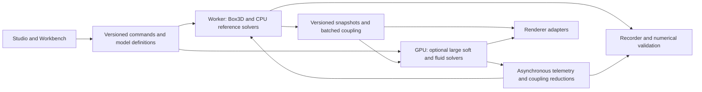

# Box3D: 100 ways to enhance and optimize the engine

**Original audit and preserved 100-item backlog.** Audit date: 2026-09-10; initial `main` was `dfedd9fe9983200f492d686488d27b6a4b11c650`, including the then-uncommitted Studio changes. The findings below describe that initial snapshot. Implementation has since begun: see [current progress](ENGINE_100X_PROGRESS.md), [the item-by-item status ledger](ENGINE_100X_STATUS.json), and [GPU water API/evidence](GPU_WATER_API.md). These original proposals and historical audit measurements are retained rather than rewritten as current results. The application owner has since replaced the legacy workbench entry with an eight-study Studio.

The strongest route to a much more capable engine is to connect the Studio to a shared simulation contract, move simulation work off the UI thread, keep large deformable/fluid simulations on the GPU, and remove capacity and coupling limits. Small CPU optimizations remain useful, particularly in the new Studio, but they do not establish a universal 100× speedup.

## What the source and fresh checks establish

| Finding | Current evidence | Implication |
|---|---|---|
| The default route now opens a separate simulation stack. | `src/entry.ts` loads the Studio; `src/studio/main.ts` constructs `FailureSimulation`, while the workbench loads native Box3D and `SoftSimulationSuite`. | Improvements to the legacy WASM engine do not automatically improve the default Studio. |
| Rigid simulation is deliberately single-worker and capped. | `wasm/box3d_web.c` sets `workerCount = 1`, uses a global world, and defines `B3W_MAX_BODIES = 4096`. | Parallel native work, independent worlds, and larger capacities require bridge changes. |
| GPU presentation is already optimized. | Intact cloth/water use compact state, ropes/material members use compute expansion, and rigid colors/transforms have separate versions. | Recommending generic instancing, SIMD, or upload caching would repeat delivered work. |
| Numerical soft simulation is still on CPU. | Cloth/rope/water use JS or WASM; material failure uses TypeScript. | GPU numerical solvers are a distinct opportunity from the existing GPU presentation. |
| The Studio has concrete allocation and geometry work. | `snapshot()` creates arrays through `flatMap`/`map`; `StudioWorld.update()` rebuilds indices and normals while running. | Reusable snapshots and topology-aware updates are bounded early improvements. |
| The legacy render timer measures CPU submission. | `render()` returns elapsed CPU time after `queue.submit()`; adapter requests currently include texture-compression features. | GPU pass time and frame pacing need separate measurements. |
| Some foundations already exist but are unwired. | `FrameBudgetGovernor` is defined in `src/perf/runtime.ts` with no callers found in `src`/`tests`. | Integrate and qualify the existing governor before writing another one. |
| Model scope is broader than simple rigid bodies, but coupling is incomplete. | The port docs distinguish synchronized actions from arbitrary two-way contacts; the Studio river explicitly describes itself as visual water. | Coupling, calibrated models, and real water state expand capability rather than merely improving FPS. |

Fresh verification completed on the initial inspected state:

- `npm run typecheck`: passed.
- `node scripts/native-box3d-soak.mjs`: passed; 800 scenes, 800 deterministic replays, 1,146,480 body-frames per catalog pass, and the 4,096-body maximum exercised. This is a short catalog replay plus action/stream test, not long-duration physical accuracy proof.
- `node tests/studio/failure.test.mjs`: 26/26 passed, including supports, rupture, finite state, reset, and deterministic replay.

**Final source recheck:** concurrent Studio edits added press settings/cycle behavior and changed `src/studio/main.ts`, `src/studio/physics.ts`, and `src/studio/world.ts` after the probe. The hot-path findings were rechecked and still apply. Typecheck passed again, but the Studio suite now stops at [the plate plasticity assertion](/Users/commander/box3d-WEBGPU/tests/studio/failure.test.mjs:46), `assert.ok(plastic > .02)`. Reconcile the changed press behavior and the intended test contract before accepting further solver changes; this failure alone does not establish which behavior is physically correct. Item 5 includes that immediate task. The initial 26/26 result and CPU timings must not be presented as validation of the later press revision. Both states are distinguished in the audit receipt.

An exploratory Node v26.0.0 / darwin-arm64 CPU probe ran five fresh service-load simulations per Studio study, with 120 warmup steps, 360 timed steps, and 120 snapshot calls per sample. Values below are medians of the per-sample means. The tested physics source hash remained unchanged during that probe; the table describes the pre-press-edit audit state, not the later revision.

| Studio study | Nodes / links | CPU ms per 1/120 s step | CPU ms per snapshot | Typed bytes allocated per snapshot |
|---|---:|---:|---:|---:|
| Canopy | 891 / 5,048 | 2.191 | 0.102 | 19,304 |
| Plate | 957 / 5,434 | 2.451 | 0.110 | 20,746 |
| Bridge | 148 / 327 | 0.170 | 0.014 | 2,695 |

At 60 display frames per second and normal speed, the Studio needs roughly two 120 Hz steps per display frame. The probe therefore suggests about 4.38 ms of canopy stepping or 4.90 ms of plate stepping per display frame, before snapshots, geometry updates, UI, and GPU work. This is a derived CPU budgeting illustration, not a measured browser frame time. Temporary JS arrays also consume memory beyond the typed-byte column. The hardware model was unavailable to the sandbox; no historical machine identity is assumed.

Full probe samples, commands, limitations, and SHA-256 identities of 26 inspected files are retained in [the audit receipt](/Users/commander/box3d-WEBGPU/docs/engine-100x-audit-2026-09-10.json). No fresh browser FPS, physical-GPU timing, mobile, or thermal baseline was collected.

The retained v1.13 campaign reports **1.0544×** for 555 eligible changed CPU paths, approximately **5.16% less time**. Its earlier soft-system comparisons and dramatic sleeping/cache ratios have different scopes. They cannot be multiplied into an engine-wide figure. That historical result is documented in [PERFORMANCE.md](/Users/commander/box3d-WEBGPU/PERFORMANCE.md:13); it does not measure the current Studio.

## Define the 100× goal before implementing it

Use four separate scorecards:

| Scorecard | Definition | Proposed milestone |
|---|---|---|
| Active simulation throughput | Identical bodies/constraints/cells, fixed simulation time, input sequence, solver quality, and hardware; baseline elapsed time divided by candidate elapsed time. | Demonstrate 2×, then 10× on named bottlenecks. Investigate 100× only for a suitable GPU workload. |
| Interactive capacity | Largest active problem satisfying the same error tolerance, visual preset, and p95/p99 frame budgets. | Measure `N0`, then attempt `10 × N0` and `100 × N0` on a named fluid/deformable workload. |
| Rendering capacity | Visible detail at fixed resolution, image-error tolerance, and frame budget. | Record visible triangles/instances and GPU milliseconds separately from simulation capacity. |
| Engineering capability | Supported phenomena, coupled interactions, resumable experiments, and validated material response. | New tested capabilities; no artificial numeric speed multiplier. |

For illustration, replacing a 10,000-active-node reference with 1,000,000 active nodes would be a 100× capacity result only if timestep, accepted error, rendering requirements, and frame budget still pass. Those counts are hypothetical; the current capacity frontier has not been measured. Static scenery, sleeping bodies, reduced precision, and lower simulation frequency must be reported explicitly.

Amdahl's law also matters: accelerating 90% of a serial workload by 100× yields `1 / (0.10 + 0.90 / 100) = 9.17×` overall. CPU/GPU overlap makes the frame dependency graph more complex, so measure the complete pipeline rather than multiplying subsystem wins.

## Architecture decision

| Option | Benefit | Cost and constraint | Recommendation |
|---|---|---|---|
| Continue only with local CPU optimizations | Low migration risk; useful Studio wins. | Leaves main-thread scheduling, GPU compute, and coupling limits. | Use for the first bounded improvements. |
| Shared runtime, worker-owned CPU reference, optional GPU soft solvers | Preserves validated Box3D behavior; supports both shells, larger simulation, and headless experiments. | Requires explicit state ownership, backend contracts, and numerical error policy. | **Preferred architecture.** |
| Replace every solver with a new GPU engine | Maximum research freedom. | Rebuilds rigid collision, constraints, determinism, tooling, and backend support together. | Separate research branch only if later measurements justify it. |

The preferred design keeps model identity independent of the renderer. Existing Studio studies can remain versioned reduced models during migration; sharing a contract must not silently substitute different physics beneath a familiar UI. Workers improve responsiveness; they are not automatically a throughput gain. GPU numerical modes retain a CPU reference and publish their numerical/replay guarantees.

## How to read the 100-item backlog

**P0** establishes measurement, correctness, or removes an observed integration obstacle. **P1** is the main implementation wave. **P2** is conditional research or later capability work. Priority is not execution order: prerequisites still apply.

Effort describes an initial qualified implementation by one experienced engineer: **S** approximately 1–2 days, **M** 3–7 days, **L** 2–4 weeks, **XL** more than 4 weeks or substantial research. These are rough planning estimates, exclude broad production rollout, and are not commitments. **T** = throughput/latency, **C** = capacity, **F** = fidelity/new physics, **R** = reliability, **W** = workflow. Evidence IDs resolve to the inspected source map below. Entries extend both actual gaps and relevant directions already mentioned in the existing port roadmap; this is not a claim of 100 previously unknown inventions.

Every timing target below is a proposed acceptance criterion. Exact work-elimination changes must preserve reference results; numerical changes need declared tolerances and a new solver identity. A feature that adds physics can legitimately cost more time while earning an F benefit.

### 1–10: Measurement and shared architecture

| ID | Priority / effort | Benefit | Concrete enhancement | Acceptance target | Basis |
|---:|---|---|---|---|---|
| 1 | P0 / M | R | Establish a current baseline that includes both the default Studio and workbench, with source, WASM, assets, browser, quality, and seed identities. Preserve the old frozen tournament as historical evidence. | Reproduce each baseline from its manifest; distinguish cold/warm, active/settled, and current/historical results. | E01, E14, E16 |
| 2 | P0 / M | T | Instrument CPU stepping, snapshots, geometry staging, command encoding, and feature-gated GPU pass timestamps. Use a nonblocking ring of query/readback buffers. | Attribute p50/p95/p99 costs by stage; unsupported timestamps display unavailable; no per-frame GPU wait. | E07, E08, E10 |
| 3 | P0 / M | C | Build capacity sweeps for active rigids, cloth nodes, water cells, contacts, material constraints, transparent instances, and recording duration. | Record the largest passing workload at fixed quality/error and 16.67 ms p95 / 25 ms p99 interactive targets; derive `N0` from evidence. | E02, E04, E09 |
| 4 | P0 / M | R | Extend the benchmark gate to current Studio and complete frame workloads using isolated runs, balanced baseline/candidate order, and an unchanged control population. | Reject material regressions using predeclared thresholds and confidence intervals; preserve raw samples and source identities. | E14, E16 |
| 5 | P0 / L | F | Add numerical acceptance suites beyond finite-state/hash tests: constraint residuals, penetration, momentum, mass, strain, energy/work, and failure sequence. First reconcile the plate plasticity assertion that failed after the concurrent press changes. | Each solver has a declared error envelope and long-horizon/action stress cases; exact optimizations retain exact reference output; intended press behavior and tests agree. | E04, E05, E15, E16 |
| 6 | P0 / L | R/W | Introduce a shared engine/model adapter for Studio and workbench, covering commands, stepping, topology versions, state, and telemetry. Preserve each model's identity during migration. | Run one model headlessly and in both shells with identical fixed-step commands and outputs; no UI-dependent physics behavior. | E01, E03, E09 |
| 7 | P0 / M | R | Replace scattered backend assumptions with one capability registry: model/solver ID, JS/scalar/SIMD/threaded/GPU mode, render backend, limits, and guarantees. Extend existing badges and diagnostics. | Every run/export records the actual selected capabilities; unsupported combinations fail or select an explicitly identified fallback. | E03, E07, E10, E15 |
| 8 | P1 / M | W | Expose a headless `create → command → step → inspect → destroy` runtime API instead of relying on DOM-driven orchestration for experiments. | The same command file runs in a Node/browser worker harness and interactive shell; every instance releases owned resources. | E03, E08, E09, E15 |
| 9 | P1 / L | F/W | Compile native and preview scenes from a common versioned recipe representation instead of maintaining parallel procedural family staging. | Compare shapes, transforms, materials, and actions for all 800 recipes and 65 hero definitions; record intentional backend differences. | E02, E03, E18 |
| 10 | P0 / M | T | Give engineering recording a telemetry-only path. `recordEngineeringFixedStep()` currently calls `soft.buildFrame(false)` and native hashing on every recorded tick. | Record the required 60 Hz channels without building render geometry per tick; at most one presentation build per displayed state; preserve evidence semantics. | E04, E08, E15 |

GPU timestamps require the optional feature and pass query writes; CPU submit time is a different measurement. See [GPU query documentation](https://developer.mozilla.org/en-US/docs/Web/API/GPUDevice/createQuerySet). The instrumentation and priorities above are recommendations inferred from this engine's source.

### 11–20: Main-thread and Studio hot paths

| ID | Priority / effort | Benefit | Concrete enhancement | Acceptance target | Basis |
|---:|---|---|---|---|---|
| 11 | P1 / L | T | Move fixed-step native/soft/Studio stepping into a dedicated worker behind the shared contract. Keep command order and model time authoritative there. | UI remains responsive during a deliberately overloaded simulation; command-to-visible-state latency is measured; same-backend replay still passes. | E06, E08, E09, E11 |
| 12 | P1 / M | T | Add a reusable transferable snapshot pool with ownership states and backpressure for deployments without shared memory. | No detached-buffer reuse or unbounded message queue; measure transport overhead against the current direct path. | E03, E04, E11 |
| 13 | P1 / L | T/C | Add an optional SharedArrayBuffer snapshot ring with atomic publication and scene generations, gated by cross-origin isolation. | No torn snapshot reads under stress; compatibility path still works; transfer cost falls without blocking the browser thread. | E03, E06, E17 |
| 14 | P1 / M | T | Interpolate presentation between timestamped physics snapshots, including quaternion rotation and discontinuity handling. | Smooth 60/120/144 Hz display against fixed stepping; reset, teleport, and fracture never interpolate across incompatible topology. | E03, E08, E11 |
| 15 | P0 / M | T/R | Formalize accumulator overload behavior and wire the existing governor into presentation decisions. Current loops cap per-frame step count but retain backlog. | Overload and dropped wall time are visible; no growing catch-up spiral; scientific recording pauses or reports lag instead of silently skipping simulation ticks. | E08, E11, E13 |
| 16 | P1 / L | T | Convert the Studio's object-per-particle/link solver to stable typed arrays, using the legacy soft kernels' data layout experience. Preserve traversal and arithmetic order first. | Lower stepping CPU time and allocation rate for all three studies; exact same-version service/failure regression outputs before numerical redesign. | E06, E09 |
| 17 | P0 / M | T | Add `snapshotInto()` or equivalent reusable live snapshot storage; allocate immutable copies only at recording/checkpoint boundaries. | Zero new large typed buffers per live frame after warmup; saved frames remain immutable; compare against the 19–21 KB canopy/plate snapshot allocations. | E09, E11 |
| 18 | P0 / S | T | Rebuild and upload Studio surface index buffers only when topology changes. Reuse precomputed border connectivity and explicit replay topology identities. | No index upload on intact motion; torn faces remain absent; backward scrubbing reconstructs the correct topology. | E09, E10 |
| 19 | P1 / M | T | Remove per-node temporary position arrays, temporary color objects, and repeated perimeter-pair construction from `StudioWorld.update()`. | Allocation profiling shows stable hot-path storage; visual transforms/colors and severed-link visibility match the reference. | E10 |
| 20 | P1 / M | C/W | Replace snapshot-history splicing with a bounded ring plus asynchronously persisted chunks, retaining compact chart samples separately from full geometry snapshots. | Long recordings remain within a configured memory budget; sample timestamps stay ordered; timeline seeking works across persisted chunk boundaries. | E11, E13, E15 |

Workers and pthreads are distinct layers. Shared-memory deployment needs COOP/COEP, and Emscripten requires separate threaded and nonthreaded binaries; build and hosting selection belong in the capability contract. See [Emscripten pthread support](https://emscripten.org/docs/porting/pthreads.html). Partial attribute updates should use supported mechanisms such as [Three.js update ranges](https://threejs.org/docs/pages/BufferAttribute.html).

### 21–30: Native rigid-body scale and API

| ID | Priority / effort | Benefit | Concrete enhancement | Acceptance target | Basis |
|---:|---|---|---|---|---|
| 21 | P1 / XL | T | Connect Box3D's task scheduling to a bounded Emscripten pthread pool instead of `workerCount = 1`; implement task callbacks and a separately selected threaded artifact. | Benchmark 1/2/4/8 workers on contact-heavy scenes, including startup/transport; prove deterministic guarantees per supported mode and retain single-thread deployment. | E02, E17 |
| 22 | P1 / L | C | Replace the native bridge's fixed 4,096-body arrays and renderer cap with bounded, growable capacity tiers and explicit allocation-failure reporting. | Exercise 4K/16K/64K active-body staging without truncation or stale heap views; publish actual contact-heavy frame times and memory use. | E02, E03, E07 |
| 23 | P1 / M | C | Add body destruction, slot reuse, and generation-checked handles for projectiles, debris, and streamed scenes. | A million spawn/despawn operations maintain bounded live storage; stale IDs never mutate newly recycled bodies. | E02, E03 |
| 24 | P1 / L | T | Export position, quaternion, and scale instead of full 4×4 rigid matrices; reconstruct transforms in shaders. Prototype a 40-byte float32 record before considering lossy packing. | Reduce dynamic transform payload from 64 to 40 bytes/body; validate reconstructed positions/normals and benchmark total CPU/upload/GPU cost. | E02, E03, E07 |
| 25 | P2 / M | T | Evaluate coarse block dirty ranges for mixed sleeping/awake transform uploads, with a dense-upload threshold. This differs from the previously rejected sparse move-event synchronization. | Win on defined large mixed-activity workloads without regressing dense scenes; include range detection and write-call overhead in timing. | E02, E07, E14 |
| 26 | P1 / L | C/W | Replace native global world state with explicit world contexts and per-world buffers, seeds, handles, and lifetimes. | Multiple independent simulations can run/reset without cross-contamination; destruction and replay remain isolated. | E02, E03 |
| 27 | P1 / L | F | Expose sphere, capsule, convex, mesh, compound, and heightfield geometry through the bridge and render the matching shape instead of only cube-hull instances. | Query, collision, inertia, and visible geometry agree on a shape-parity suite; qualify support against the pinned upstream version. | E02, E03, E07, E18 |
| 28 | P1 / L | F | Expose supported native joints, limits, motors, and kinematic targets through typed commands and diagnostics. | Pendulum, slider, actuator, and driven mechanism tests meet declared limit/constraint errors; revise sleeping early-outs for kinematic/motor activity. | E02, E03, E18 |
| 29 | P1 / L | F | Add batched ray/shape casts, overlaps, contact events, and contact-impulse streams to the C ABI, with stable body/shape IDs. | Contact/query results support picking and coupling without per-contact JS/WASM calls; report overflow and retain deterministically ordered events. | E02, E03, E18 |
| 30 | P2 / M | T | Qualify collision layers and per-body continuous-collision policies for authored scene classes. Sleep and CCD already exist; tune eligibility rather than adding them again. | Reduce unnecessary pair/CCD work while thin-wall, high-speed, sensor, and wake-up regression cases remain correct. | E02, E03, E14 |

Upstream already documents multiple collision-shape and event capabilities; the proposal is to expose and qualify them in this browser bridge, not claim they were missing from Box3D itself. See the [pinned Box3D v0.1.0 documentation](https://raw.githubusercontent.com/erincatto/box3d/v0.1.0/README.md). Threading and larger buffers will change native build/replay contracts and must not inherit the existing frozen benchmark identity.

### 31–40: Deformable solver quality and efficiency

| ID | Priority / effort | Benefit | Concrete enhancement | Acceptance target | Basis |
|---:|---|---|---|---|---|
| 31 | P1 / L | F | Introduce compliant XPBD constraints where cloth/rope/Studio still rely on iteration-dependent PBD stiffness. Reuse the material shell's existing compliance concepts where appropriate. | Calibrated extension/bending response stays within a declared tolerance across timestep and iteration sweeps; record constraint-force estimates. | E04, E05, E09 |
| 32 | P1 / L | T | Extend existing qualified adaptive schedules with residual-based convergence and explicit contact/damage escalation rules. | Lower solver work at the same residual/error target; preserve conservative tearing/contact modes and long-horizon qualification. | E04, E05, E14 |
| 33 | P2 / XL | T/C | Add a hierarchical constraint solve for large membranes, using coarse-to-fine corrections to address long-range stretch. | At equal strain/shape error, outperform the flat solver on increasing grid sizes; measure topology-change maintenance cost. | E04, E09 |
| 34 | P1 / XL | F/C | Add cloth self-collision using a spatial hash or BVH over nonadjacent surface elements and a thickness-aware narrow phase. | Folded and layered cloth avoids persistent interpenetration; neighbor-search cost scales acceptably on dense and adversarial folds. | E04, E09 |
| 35 | P1 / L | F | Replace isolated ground/sphere collision assumptions with frictional cloth/rope contact against shared rigid collider geometry. | Drape/slide/stack tests work on moving convex and mesh fixtures; contact thickness and friction are measurable. | E04, E09, E18 |
| 36 | P1 / L | F | Extend swept collision to fast soft vertices/edges and moving rigid shapes, beyond the existing projectile-specific interactions. | High-speed thin-surface tests pass over a declared velocity range; time-of-impact/subdivision cost is included in budgets. | E04, E05, E09 |
| 37 | P2 / XL | F | Add a physically parameterized cloth shell model with separate membrane stretch, shear, and bending, including directional fabric response. | Warp/weft/bias and cantilever tests converge with resolution; old normalized cloth recipes keep their original model version. | E04, E05, E09 |
| 38 | P2 / XL | F | Add orientation degrees of freedom and twist/bend constraints to cables using a Cosserat-rod model. | Torsion, buckling, and clamped-twist examples match reference behavior; simple rope mode remains available for cheaper scenes. | E04, E06 |
| 39 | P1 / M | T | Maintain compact active-constraint lists for torn Studio/soft systems, with stable external IDs and deterministic compaction at topology boundaries. | Fully broken members incur no recurring projection work; failure order and diagnostics remain reproducible after compaction. | E04, E09 |
| 40 | P2 / XL | C | Add optional adaptive simulation resolution near strain, contact, and crack fronts, with conservative state transfer and a separately identified solver mode. | Refinement/coarsening preserves mass, momentum, anchors, and accepted response; cost falls on localized-load cases without changing render-only LOD semantics. | E04, E05 |

[XPBD](https://matthias-research.github.io/pages/publications/XPBD.pdf) provides a basis for compliant constraints and force estimates; it is not inherently a faster-converging solver. Evaluate substeps and iterations together using the [Small Steps paper](https://matthias-research.github.io/pages/publications/smallsteps.pdf). Cable twist is a distinct capability described in [Position and Orientation Based Cosserat Rods](https://animation.rwth-aachen.de/media/papers/2016-SCA-Cosserat-Rods.pdf).

### 41–50: GPU numerical simulation

| ID | Priority / effort | Benefit | Concrete enhancement | Acceptance target | Basis |
|---:|---|---|---|---|---|
| 41 | P1 / L | T/C | Port the existing water field update to WebGPU compute ping-pong buffers, starting with the same equations and boundary conditions. | Beat CPU plus upload at the measured crossover size; report mass/wave/phase error and complete render-inclusive time. | E04, E06, E07 |
| 42 | P1 / XL | T/C | Port cloth integration and projection to compute using graph-colored Gauss-Seidel or qualified Jacobi batches. | No concurrent writes to a shared position within a color pass; compare equal residual quality, dispatch overhead, collisions, and long-run drift. | E04, E06, E07 |
| 43 | P1 / L | T/C | Move rope constraint solving to compute, extending the existing rope presentation path rather than confusing expansion with numerical simulation. | Large rope nets run from GPU state without CPU matrix staging or per-step readback; break/collision/load tests pass. | E04, E06, E07 |
| 44 | P2 / XL | T/C | Prototype GPU material projection and damage evaluation after the CPU material reference and tolerance suite are stable. | Match declared plastic-response and failure-event envelopes; record reduction-order/numerical differences; show whole-workload gain on large lattices. | E05, E07 |
| 45 | P0 / L | T/C | Extend frame contracts with GPU buffer ownership, offsets, counts, versions, and backend lifetimes, so GPU solvers feed rendering directly. | No mandatory full-state CPU readback in an ordinary GPU simulation frame; CPU and GPU producers remain explicitly distinguishable. | E03, E04, E07 |
| 46 | P2 / XL | C | Keep tearing topology on GPU using stable face/edge IDs, active masks, scans, and generated index counts. | Holes and detached regions remain correct without falling back to full CPU surface packing; deterministic-reference comparison accounts for event ordering. | E04, E07 |
| 47 | P1 / L | T | Compute deformation normals, strain colors, and bounds once per changed state for shared presentation, including the Studio's CPU-normal path. | Remove repeated CPU normal reconstruction; benchmark compute versus current vertex reconstruction at several mesh sizes; unchanged states do no work. | E07, E10 |
| 48 | P1 / L | C/T | Move secondary spray, foam particles, dust, and visual debris to GPU spawn/update/compaction passes with bounded pools. | Sustain a declared active-particle target without CPU object growth; presentation randomness cannot change authoritative physics replay. | E04, E05, E07 |
| 49 | P2 / M | T | Tune workgroup sizes, shared-memory tiles, and optional subgroup reductions by adapter class. Evaluate f16 only for qualified presentation/auxiliary data first. | Record per-adapter winners and fallback paths; include small workloads; reject numerical or whole-frame regressions despite microkernel wins. | E06, E07 |
| 50 | P1 / L | T | Reduce GPU telemetry to requested scalars/events and read it back through a bounded asynchronous staging ring, with timestamps and age tracking. | Display and recording never block each frame on `mapAsync`/queue completion; delayed channels retain correct simulation timestamps and declared latency. | E07, E08, E15 |

Subgroups are optional: request them only when supported, avoid assuming a fixed subgroup size, and retain a portable kernel. See [Chrome's subgroup feature documentation](https://developer.chrome.com/blog/new-in-webgpu-134). GPU work introduces dispatch and synchronization costs, so small cloth/water cases may remain faster on the existing CPU path. Cross-device bitwise determinism must be demonstrated, not assumed.

### 51–60: Two-way coupling and useful fluid simulation

| ID | Priority / effort | Benefit | Concrete enhancement | Acceptance target | Basis |
|---:|---|---|---|---|---|
| 51 | P1 / L | F/R | Introduce a shared collider/interaction registry with stable IDs and one owner per projectile, fixture, or payload. Replace duplicated cross-domain action proxies incrementally. | One physical projectile produces one contact history across rigid/soft domains; no duplicated mass or double-applied impulse. | E02, E04, E05, E18 |
| 52 | P1 / XL | F | Add a staged coupling solve that exchanges soft contact and attachment reactions with Box3D instead of only broadcasting actions to both systems. | Equal/opposite impulse accounting and bounded energy error in two-body/contact tests; strong-coupling cases remain stable under timestep refinement. | E03, E04, E05, E18 |
| 53 | P1 / L | F | Support moving rigid attachments, pulleys, and winch length control for ropes through the shared joint/coupling interface. | A crane payload loads the hoist and support body; winch work, tension, and motor limits are observable rather than visual-only motion. | E03, E04, E18 |
| 54 | P1 / XL | F | Couple water buoyancy and drag to actual rigid hulls and return displaced volume/momentum to the field. Extend existing floater proxies. | A floating body changes the water and vice versa; static float height and drag tests meet declared tolerances with stable force feedback. | E02, E04, E18 |
| 55 | P1 / L | F | Add water bathymetry and obstacle masks to replace a uniform basin assumption, with boundary conditions derived from terrain and moving obstacles. | A variable-depth lake-at-rest remains still within tolerance; channels, piers, and shore boundaries redirect flow correctly. | E04, E06, E12 |
| 56 | P2 / XL | F | Add a separate nonlinear shallow-water mode with a well-balanced, positivity-preserving wetting/drying treatment. Preserve the current linear model for its intended cases. | Pass dry-front, dam-break, still-lake, and mass-balance cases; enforce a declared CFL policy; report resolution/time convergence. | E04, E06 |
| 57 | P2 / XL | C | Tile large water/deformable domains with halo exchange and scalable topology indexing; use chunk-local indices or uint32 instead of assuming every surface fits uint16. | A million-cell target domain crosses tile boundaries without seams, lost flux, or index overflow; capacity and transfer costs are reported. | E03, E04, E07 |
| 58 | P1 / L | C/F | Generalize the single active surface/frame into a collection of independently versioned cloth, water, and sheet surfaces with per-surface resource lifetimes. | Render and step multiple flags, basins, and material specimens simultaneously; mutations on one surface do not force unrelated uploads. | E03, E04, E05, E07 |
| 59 | P2 / XL | F | Prototype an optional volumetric particle-fluid mode for overturning splashes and free surfaces that the heightfield cannot represent. Start with a bounded PBF/SPH research scene. | Demonstrate a genuinely volumetric case with measured density/mass error and collision quality; publish the much higher compute/memory cost. | E04, E07, E18 |
| 60 | P1 / L | F | Drive Studio river displacement, flow, and foam from the actual water solver through a renderer adapter, while retaining the existing visual river as an explicit mode. | A changed obstacle or physical disturbance alters both measured water state and the visible river; visual presets do not fabricate physical currents. | E04, E12 |

Nonlinear shorelines require a numerical method change, not merely a shader change. A relevant starting point is the research on [well-balanced wetting/drying reconstruction](https://arxiv.org/abs/1412.3580); its described one-dimensional construction is not a ready-made implementation for this engine's two-dimensional fields. Coupling targets above are proposed validation requirements, not results already achieved here.

### 61–70: Material realism and fracture scale

| ID | Priority / effort | Benefit | Concrete enhancement | Acceptance target | Basis |
|---:|---|---|---|---|---|
| 61 | P1 / XL | F | Add explicitly unit-bearing material parameters and a calibration workflow with measured source datasets, specimen geometry, and parameter validity ranges. Retain normalized presets separately. | Fit and validate against distinct datasets; exports distinguish normalized and calibrated model versions and retain units/uncertainty/provenance. | E05, E09, E15 |
| 62 | P1 / L | F/R | Build a material convergence matrix over specimen mesh, timestep, solve slices, and loading rate, extending the existing deterministic 100-case material campaign. | Load-deflection curves, residual dent, and failure onset converge within declared envelopes; altered solver resolution cannot silently change conclusions. | E05, E15, E16 |
| 63 | P1 / L | T | Port the TypeScript material projection/damage hot loops to scalar and SIMD WASM, keeping the TypeScript implementation as the reference. | Demonstrate speedup on actual material workloads including state handoff; all 100 existing material cases and new load/strike cases pass. | E05, E06, E17 |
| 64 | P2 / L | T | Extend the material solver's existing active-distance-member filtering with connected-island scheduling and conservative inactivity detection for undamaged idle regions. | Skip only regions with no changing load/contact/damage driver; wake neighboring regions correctly; fatigue/loading histories match the reference. | E05 |
| 65 | P2 / XL | F | Add a physically parameterized elastoplastic material option with hardening and directional response, beyond normalized rest-length creep and threshold tuning. | Uniaxial load/unload, cyclic hardening, and directional coupon results match declared constitutive references; new state is checkpointed. | E05, E15 |
| 66 | P2 / XL | F | Add fatigue accumulation tied to measured stress/strain cycles and material data, including cycle counting and model applicability ranges. | Predict held-out cyclic tests within a reported uncertainty interval; distinguish accumulated normalized damage from a calibrated fatigue prediction. | E05, E15 |
| 67 | P2 / XL | F | Make cohesive fracture mesh-objective by relating energy release and damage evolution to element size and material fracture energy. Extend existing cohesive cells/crack fronts. | Refined meshes do not arbitrarily change total fracture work or failure load; compare crack paths and energy balance across resolutions. | E05 |
| 68 | P1 / L | F | Promote detached material fragments from local ballistic/ground-contact proxies into native rigid bodies, using bounded hull generation and conserved launch state. | Fragments collide with external bodies and each other; transferred mass, momentum, and body budgets are accounted for; stable IDs survive promotion. | E02, E03, E05 |
| 69 | P2 / XL | F | Add material-surface self-contact and persistent contact against punches, fixtures, and detached regions, extending the current local contacts. | Folded sheets and crushing fragments do not pass through each other; contact convergence and frictional work are measured. | E05, E18 |
| 70 | P2 / XL | F | Extend reinforced concrete from persistent bridging constraints to bond-slip and pullout behavior with measured reinforcement/concrete interface parameters. | Rebar transfers load after cover loss with testable slip, anchorage, and pullout behavior; strain and interface work remain distinct channels. | E05, E15 |

These are material-model extensions. The current engine already supports plastic set, fatigue-like damage, fracture, spall, and rebar presentation; those delivered capabilities are not being counted again. Parameter fitting alone cannot fix an inappropriate constitutive model.

### 71–80: Rendering throughput and frame cost

| ID | Priority / effort | Benefit | Concrete enhancement | Acceptance target | Basis |
|---:|---|---|---|---|---|
| 71 | P1 / L | C/T | Add spatial bounds and view-frustum culling to the legacy all-instance draw stream; use independent light-frustum eligibility for shadows. | Offscreen instances stop consuming main-pass vertex work; camera-edge and offscreen-shadow-caster tests retain correct visibility. | E02, E07 |
| 72 | P2 / L | C/T | Add conservative hierarchical-depth occlusion culling for sufficiently large opaque scenes after frustum culling. | Urban/warehouse scenes reduce GPU work; camera cuts, moving occluders, and disocclusion show no visible popping; small scenes can bypass it. | E07 |
| 73 | P1 / L | C/T | Generate visible instance lists and indirect draw arguments on GPU, grouped by geometry/material class, with a direct-draw fallback. | Rendering scales with visible batches without CPU count readback; no reliance on nonportable multi-draw or unsupported nonzero first-instance behavior. | E07 |
| 74 | P0 / M | T | Partition opaque and transparent instance ranges. The legacy transparent pass currently redraws `safeCount` whenever any stream contains transparency. | The transparent draw visits only transparent instances; preserve depth/blending behavior and measure vertex/fragment reduction on mixed scenes. | E07 |
| 75 | P1 / L | T | Cache static shadow contributions and update dynamic casters separately; fit shadow coverage to the active experiment and invalidate on relevant light/scene changes. | Static frames avoid redundant shadow rendering; moving geometry, camera-dependent bounds, and low sun remain correct across both renderers. | E07, E10 |
| 76 | P1 / L | C | Add screen-error-based rendering LOD for general rigid geometry, distant rope thickness, debris, and decorative stage details. Keep the physics mesh independent. | Increase visible scene capacity at a predeclared image-error limit; inspection views retain needed detail; physical results remain unchanged. | E07, E10 |
| 77 | P1 / M | T | Use measured GPU/frame cost to adjust render resolution and selected effects with hysteresis. Extend the existing quality presets and unused governor. | Meet the selected p95 budget without oscillation; exports/benchmark comparisons lock quality; simulation dt and material parameters remain unchanged. | E07, E10, E13 |
| 78 | P2 / M | T | A/B test a depth prepass and opaque front-to-back ordering for expensive, overdraw-heavy scenes. Enable only above a measured crossover. | GPU savings exceed added geometry/encoding cost; test both sparse scenes and heavy material overlap. | E07, E10 |
| 79 | P2 / XL | C/F | Add tiled or clustered local-light assignment if many dynamic lights become a product requirement. Preserve the existing cheaper directional/environment-light path. | Bound per-fragment light work in a 100-local-light stress scene; verify light-list overflow, specular response, and GPU cost. | E07, E10 |
| 80 | P2 / L | T | Build a measurable post-processing resource graph with pooled transient targets and selectively downsampled bloom/AO, extending the existing HDR and Studio AO passes. | Lower render-target bandwidth/peak bytes at accepted image quality; resizing and quality transitions recreate dependent bindings safely. | E07, E10 |

GPU indirect draws accept arguments from buffers; portable operation must account for optional nonzero `firstInstance`. See [drawIndexedIndirect documentation](https://developer.mozilla.org/en-US/docs/Web/API/GPURenderPassEncoder/drawIndexedIndirect). Culling and prepasses are conditional optimizations: their maintenance and extra passes must beat the work they remove. The Studio already has Three.js culling/instancing/merged scenery; the legacy stream and dynamic Studio bounds need separate treatment.

### 81–90: Assets, large worlds, and resource lifetime

| ID | Priority / effort | Benefit | Concrete enhancement | Acceptance target | Basis |
|---:|---|---|---|---|---|
| 81 | P1 / L | F/W | Generalize the Studio's existing GLTF scenery loading into an asset pipeline that cooks render meshes, collision geometry, material bindings, units, and bounds for authored simulations. | Import one asset consistently into both shells; visual geometry and collider scale agree; unsupported assets produce actionable diagnostics. | E02, E10, E12, E18 |
| 82 | P1 / M | T/C | Apply offline meshoptimizer/gltfpack-style indexing, cache/fetch optimization, and simplification to imported static assets, beyond runtime mesh merging already present. | Smaller/faster assets pass silhouette, UV, normal, and material checks; measure parse/upload/render costs as well as download bytes. | E10, E12 |
| 83 | P1 / L | C/T | Extend compressed texture delivery to the Studio's PNG/WebP material library using KTX2/Basis and capability-aware targets, preserving the legacy direct ASTC/BC path. | Compare transfer bytes, resident texture payload, transcode startup, and normal-map quality across supported devices; retain appropriate fallback formats. | E07, E12 |
| 84 | P1 / L | C/T | Stream texture/mesh detail by demand with cancellation and residency budgets, instead of letting every visited finish/asset remain permanently resident. | Rapid scene changes cancel obsolete work; memory stays within a configured budget; required visible assets recover without broken bindings. | E10, E12 |
| 85 | P1 / L | C/T | Make Studio vegetation spatially clustered with camera-dependent density/LOD and conservative bounds. Extend current instanced/tiered woodland rather than adding generic instancing. | Wide bridge views reduce hidden/distant vegetation work; nearby trees retain silhouette/shadow quality; no asset identity changes in evidence captures. | E10 |
| 86 | P0 / M | T | Load and compile the active study's necessary assets first. Defer unrelated study finishes and optional environments; preserve existing asynchronous pipeline creation. | Measure time to first interactive specimen under cold cache and slow transfer; no blank materials or shader stalls when deferred content becomes visible. | E01, E07, E10, E12 |
| 87 | P0 / L | R/C | Add complete resource-owner lifecycles for both renderers: device buffers, targets, materials, textures, controls, observers, workers, and async tasks. Extend existing partial disposal. | Repeated create/switch/destroy cycles plateau in owned resource counts and allocated bytes; no callbacks touch disposed objects. | E07, E10, E12 |
| 88 | P0 / L | R | Add explicit mid-session GPU device-loss recovery: preserve CPU state or the latest GPU checkpoint, reselect capabilities, recreate resources, and report recovery status. | Deliberately lose the device during running, paused, recording, and resize states; recover a valid scene or a clear recoverable error. | E07, E10 |
| 89 | P2 / XL | C/F | Add regional coordinates/floating origins and explicit world-to-local transforms for large engineering sites, including collider, camera, and recorder coordinates. | Move scenes through large world coordinates while local contact/strain accuracy stays within tolerance; exports retain consistent world positions. | E02, E03, E07, E15 |
| 90 | P2 / M | T/R | Add a versioned, integrity-checked persistent asset cache and offline package manifest for repeat lab use; coordinate invalidation with native/shader revisions. | Repeat/offline startup uses the correct cached release; mixed-version assets cannot silently load; cache quotas and recovery are tested. | E01, E12, E17 |

[meshoptimizer](https://github.com/zeux/meshoptimizer) provides concrete mesh-cooking algorithms, and [KHR_texture_basisu](https://github.com/KhronosGroup/glTF/blob/main/extensions/2.0/Khronos/KHR_texture_basisu/README.md) specifies KTX2/Basis delivery and platform transcoding. Both need engine-specific quality and startup measurements. Mid-session recovery should handle the [GPU device-loss lifecycle](https://developer.mozilla.org/en-US/docs/Web/API/GPUDevice/lost), beyond the Studio's existing startup WebGL fallback.

### 91–100: Production use, experiments, and validation

| ID | Priority / effort | Benefit | Concrete enhancement | Acceptance target | Basis |
|---:|---|---|---|---|---|
| 91 | P1 / L | R/F | Define renderer adapters over shared engine state and explicit quality/capability semantics for raw WebGPU, Three.js WebGPU, and the Studio's existing WebGL fallback. | Renderer selection cannot silently change the physics model; missing render features are declared; the workbench's intentional WebGPU requirement stays explicit. | E01, E03, E07, E10 |
| 92 | P1 / M | R/W | Split inline WGSL and the large renderer/coordinator modules into owned shader/pass/runtime modules, with interface layout checks and shader compilation coverage. | Existing hardware shader validation still passes; WGSL/CPU layouts are checked together; no bundle/startup/per-frame regression from modularization. | E07, E08, E16 |
| 93 | P1 / L | W/F | Add authoring for parameterized fixtures, collider attachments, load programs, and model settings using the shared scene schema and reversible commands. Extend the existing presets/scene desk. | An authored experiment round-trips with stable IDs and reproduces the same results; undo edits topology/settings without corrupting saved runs. | E01, E09, E15, E18 |
| 94 | P1 / XL | R/W | Extend existing run/evidence export into resumable checkpoints containing velocities/previous positions, damage, plastic rest state, RNG, constraints, and solver revision. | Resume mid-failure and reproduce a continuous run under the same backend; reject incomplete or incompatible state rather than treating visual snapshots as full checkpoints. | E02, E04, E05, E09, E15 |
| 95 | P1 / L | W/C | Build cancellable parameter-sweep/batch execution on the headless runtime, with bounded concurrency and separate result artifacts. | Sweep hundreds of cases without blocking the UI or overwriting benchmark evidence; report throughput, failures, cancellation, and per-case provenance. | E08, E15, E16 |
| 96 | P2 / L | W/C | Turn the existing remote TurboQuant experiment into an optional spectator/replay transport with sequence numbers, keyframes, error budgets, and loss recovery. Keep local transport uncompressed by default. | Bandwidth savings survive encode/decode and loss/reorder tests; drift and end-to-end latency are measured; authoritative solver state is never overwritten by lossy presentation data. | E03, E14, E15 |
| 97 | P1 / L | F/W | Extend recorded/synthetic single-channel analysis into explicitly bound multi-channel solver/test measurements: synchronization, units, uncertainty, sensor locations, and provenance. | Correlation/modal tools can distinguish measured inputs, solver outputs, and proxies; mismatched units or unknown channels cannot produce an unlabeled physical conclusion. | E08, E15 |
| 98 | P2 / XL | W/F | Add sensitivity analysis and bounded parameter fitting over batch experiments, including identifiability checks and held-out validation. | Recover parameters in known synthetic cases and report uncertainty/held-out fit on measured cases; expose non-identifiable or model-mismatch results. | E05, E15 |
| 99 | P0 / L | R | Expand current validation into a release matrix across both entry routes, target desktop/mobile GPUs, fallback modes, active/paused/replay states, and long thermal/memory runs. | Store numerical, GPU-error, frame-time, and visual evidence separately; include interaction and second-camera checks; do not infer universal performance from a Node/Dawn pass. | E01, E07, E10, E16 |
| 100 | P0 / M | R/W | Extend source/build provenance to current Studio, shaders, textures, and new native variants, with unique run directories and non-destructive default benchmark commands. | Reproduce packaged artifacts and trace a report to exact inputs; ordinary validation cannot overwrite frozen evidence or consume another run's temporary build output. | E14, E16, E17 |

## Prioritized implementation waves

Each wave has a measurable exit condition. Later work should follow the bottlenecks established by the earlier evidence.

| Wave | Items to prioritize | Exit condition |
|---|---|---|
| Establish the current engine | 1, 2, 3, 4, 5, 6, 7, 99, 100 | Both shells have attributable, reproducible performance and numerical baselines; model/renderer identities are explicit. |
| Remove observed overhead | 10, 15, 17, 18, 19, 74, 86, then 16, 20 | Controlled before/after evidence for Studio stepping/staging, recording, startup, and mixed transparent rendering; existing behavior preserved. |
| Unblock scale and responsive interaction | 8, 11, 12, 14, 22, 23, 26, 45, 58, 87, 88; add 13/21 where deployment supports them | Bounded resources, multiple simulations/surfaces, stable worker transport, and successful recovery; measured capacity frontier improves. |
| Prove the first GPU numerical win | 41, 47, 49, 50, then 42/43, 71/73/77 | A named active workload beats the CPU reference end-to-end at equivalent accepted quality; crossover sizes determine dispatch policy. |
| Make interactions physically useful | 27–29, 31, 35, 51–55, 60–63, 68, 94 | Coupled tests, stable material response, real river state, and exact same-backend resume are demonstrated. |
| Attempt the 100× capacity frontier | 33, 40, 44, 46, 56–59, 64–70, 72, 76, 79–85, 89, 95–98 as bottlenecks justify | A predeclared `100 × N0` active workload passes the same dt/error/quality and frame-budget gates. Publish remaining failed cases and tradeoffs. |

The first bounded optimization batch should be **17, 18, 19, and 10**, after the baseline and timing work. They target visible source-level repetition without changing the material/cloth equations. The first architectural prototype should be **6 + 11 + 12**, followed by **45 + 41 + 50** for water. Native multithreading should follow task-scheduler and deployment validation rather than changing `workerCount` alone.

Do not schedule all 100 as one release. Many P2 items are independent research programs; items such as calibrated plasticity, self-contact, volumetric fluid, and reinforcement bond-slip are substantive solver projects. A small foundation/optimization wave is plausible in weeks; the full capability backlog is a multi-month engineering effort and can extend beyond a year depending on staffing and validation depth.

## Qualification policy and design risks

- **Exact optimization:** preserve fixed-step command order, seeded state, topology, and hashes for the supported backend/version. Timer wins must include bookkeeping/transfer costs.
- **Numerical change:** register tolerances before timing. Use maximum/RMS error, conservation, residuals, and event-level measures appropriate to the phenomenon. The old intact-cloth 0.2% fidelity ceiling is a useful precedent, not a universal fracture/fluid tolerance. Chaotic late-time pointwise equality is not an adequate sole metric.
- **Quality change:** record it explicitly. Lower resolution, fewer lights, fewer active constraints, or changed precision can be useful product modes but cannot masquerade as an equivalent-workload gain.
- **Coupling:** workers/GPU introduce latency and ownership boundaries. Exchange impulses at declared simulation times; strong interactions may require extra iterations and can erase throughput gains.
- **Indexing/capacity:** increasing a native constant is insufficient. CPU/WASM memory, typed index widths, WebGPU binding limits, debug/effect capacities, and recorder storage must be audited together.
- **Parallelism:** feature-gate threads/subgroups/f16 and qualify fallback paths. Stay within available resources instead of assigning every logical CPU to every world.
- **Resource recovery:** recreate dependent resources coherently. Studio source already records stale-binding trouble when shadow targets are resized after compilation; avoid treating live shadow-size changes as a trivial knob.
- **Visual fidelity:** validate the authored experiments from normal and inspection cameras, including thin cables, glass, tear holes, and contact boundaries. Faster numerical code and valid GPU submissions do not prove correct presentation.

Known rejected paths should remain rejected until a materially different workload or mechanism justifies a new experiment. The retained performance report records local TurboQuant as 53.3× slower in its tested worker path, sparse move-event synchronization as no win, bind-group hoisting near parity, and partial uniform writes as regressions. The block-upload proposal in item 25 must demonstrate that different mechanism and include its detection cost. Preserve SIMD, settled-world skipping, numeric configuration caches, compact soft streams, and separately versioned rigid colors already delivered.

## Inspected source map

Links refer to the current local checkout; line numbers are audit navigation points and may move with later edits. The audit JSON retains file hashes for identifying this inspected state.

| Evidence ID | Source and observed responsibility |
|---|---|
| E01 | [Entry routing](/Users/commander/box3d-WEBGPU/src/entry.ts:1) and [Studio startup](/Users/commander/box3d-WEBGPU/src/studio/main.ts:26): default Studio versus workbench; separate failure model. |
| E02 | [Native bridge and capacity](/Users/commander/box3d-WEBGPU/wasm/box3d_web.c:19), [world configuration](/Users/commander/box3d-WEBGPU/wasm/box3d_web.c:287), and [transform/step behavior](/Users/commander/box3d-WEBGPU/wasm/box3d_web.c:1011). |
| E03 | [Physics and frame contracts](/Users/commander/box3d-WEBGPU/src/types.ts:4) and [WASM wrapper](/Users/commander/box3d-WEBGPU/src/physics/wasm.ts:37): native API, memory views, versioned streams, uint16 surface indices. |
| E04 | [Soft frame contract](/Users/commander/box3d-WEBGPU/src/soft/simulations.ts:117), [cloth state](/Users/commander/box3d-WEBGPU/src/soft/simulations.ts:581), [water](/Users/commander/box3d-WEBGPU/src/soft/simulations.ts:2412), and [single active suite](/Users/commander/box3d-WEBGPU/src/soft/simulations.ts:3122). |
| E05 | [Material stepping](/Users/commander/box3d-WEBGPU/src/soft/material-simulation.ts:973), [damage](/Users/commander/box3d-WEBGPU/src/soft/material-simulation.ts:1130), [fragments](/Users/commander/box3d-WEBGPU/src/soft/material-simulation.ts:1719), [shell solver](/Users/commander/box3d-WEBGPU/src/soft/material-shell.ts:1), and [combined rigs](/Users/commander/box3d-WEBGPU/src/soft/combined-material-simulation.ts:1). |
| E06 | [Soft WASM interface and arena](/Users/commander/box3d-WEBGPU/src/soft/kernels.ts:1) and [C numerical kernels](/Users/commander/box3d-WEBGPU/wasm/soft_kernels.c:1). |
| E07 | [Raw WebGPU setup](/Users/commander/box3d-WEBGPU/src/webgpu/renderer.ts:1852), [surface upload](/Users/commander/box3d-WEBGPU/src/webgpu/renderer.ts:2861), and [compute/render passes](/Users/commander/box3d-WEBGPU/src/webgpu/renderer.ts:3048). |
| E08 | [Fixed-step recorder](/Users/commander/box3d-WEBGPU/src/main.ts:3279) and [workbench frame loop](/Users/commander/box3d-WEBGPU/src/main.ts:3984). |
| E09 | [Studio model and solver](/Users/commander/box3d-WEBGPU/src/studio/physics.ts:46), [snapshot generation](/Users/commander/box3d-WEBGPU/src/studio/physics.ts:314), and [new press settings](/Users/commander/box3d-WEBGPU/src/studio/press-settings.ts:39). |
| E10 | [Studio graphics initialization](/Users/commander/box3d-WEBGPU/src/studio/world.ts:108), [quality behavior](/Users/commander/box3d-WEBGPU/src/studio/world.ts:256), and [dynamic geometry updates](/Users/commander/box3d-WEBGPU/src/studio/world.ts:685). |
| E11 | [Studio recording and animation loop](/Users/commander/box3d-WEBGPU/src/studio/main.ts:311): 120 Hz steps, per-frame snapshot, bounded frame history, replay and chart updates. |
| E12 | [Studio texture loading](/Users/commander/box3d-WEBGPU/src/studio/materials.ts:8) and [visual river](/Users/commander/box3d-WEBGPU/src/studio/river-water.ts:6). |
| E13 | [Existing arena/ring/governor helpers](/Users/commander/box3d-WEBGPU/src/perf/runtime.ts:1); governor definition at line 49 has no source callers in the inspected tree. |
| E14 | [Performance scope and rejected candidates](/Users/commander/box3d-WEBGPU/PERFORMANCE.md:1) and [frozen 1,000-case matrix](/Users/commander/box3d-WEBGPU/docs/V1.13_1000_BENCHMARK_MATRIX.md:1). |
| E15 | [Evidence schemas](/Users/commander/box3d-WEBGPU/src/workbench/engineering-evidence.ts:9), [analysis](/Users/commander/box3d-WEBGPU/src/workbench/engineering-analysis.ts:1), and [session orchestration](/Users/commander/box3d-WEBGPU/src/workbench/engineering-session.ts:1). |
| E16 | [Package commands](/Users/commander/box3d-WEBGPU/package.json:1), [native catalog/replay test](/Users/commander/box3d-WEBGPU/scripts/native-box3d-soak.mjs:1), [material campaign](/Users/commander/box3d-WEBGPU/scripts/material-fracture-100.cjs:1), and [Studio failure tests](/Users/commander/box3d-WEBGPU/tests/studio/failure.test.mjs:1). |
| E17 | [Native build graph](/Users/commander/box3d-WEBGPU/wasm/CMakeLists.txt:1), [native build script](/Users/commander/box3d-WEBGPU/scripts/build-wasm.sh:1), and [soft build script](/Users/commander/box3d-WEBGPU/scripts/build-soft-kernels.sh:1). |
| E18 | [Published port roadmap](/Users/commander/box3d-WEBGPU/docs/WEBGPU_PORT_PLAN.md:1) and [native/soft authority and coupling boundaries](/Users/commander/box3d-WEBGPU/docs/BOX3D_PORT.md:1). |

The complete table is also available as [sortable CSV](/Users/commander/box3d-WEBGPU/docs/ENGINE_100X_ROADMAP.csv). Research links beside the relevant groups support techniques and platform constraints; expected engine benefits, effort estimates, priorities, and acceptance targets are this audit's proposals.
