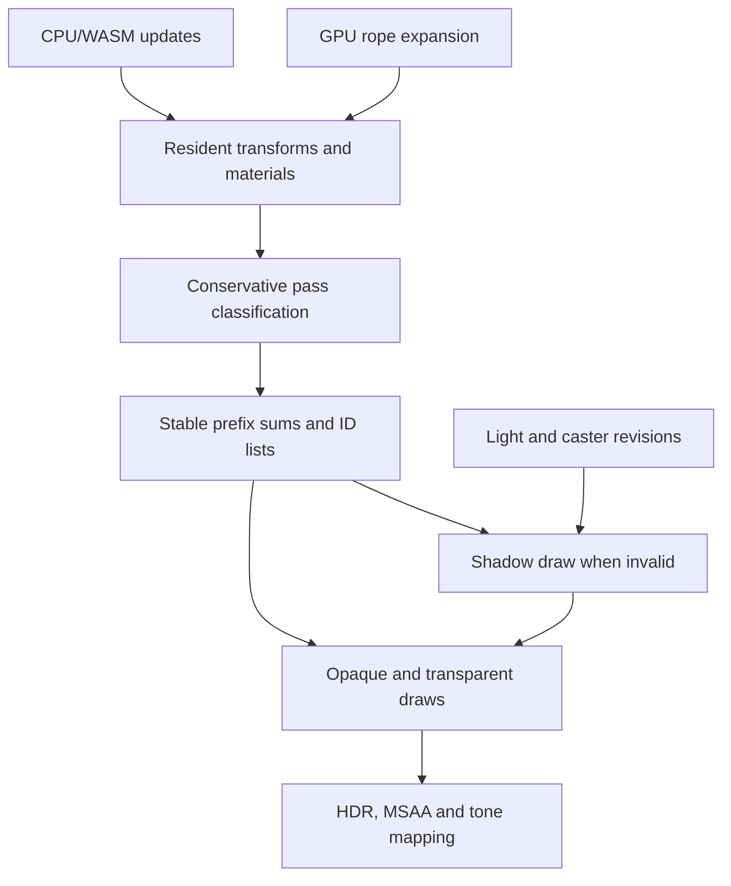
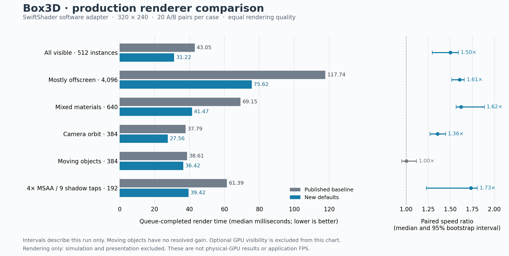
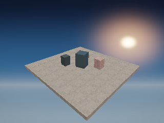
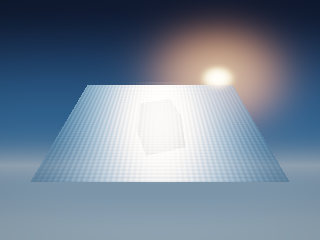
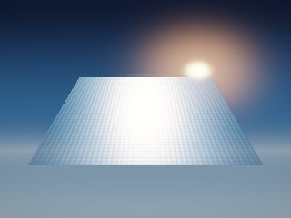

# Nanite research and Box3D rendering improvements

## Scope and baseline

This work continues the math runtime pilot on `nathansenn/box3d-WEBGPU`. The comparison baseline is commit `031724b8501b194d2da770eeb5f407a3520cb311`; the earlier pilot and its raw results remain unchanged. The implementation targets the application's WebGPU render architecture. It does not modify a GPU driver, operating-system kernel, hardware instruction set, or physics authority.

The research starting point was the previous catalogue-level review of `openai/math` at `4eaee87548250b2682affda7d05d947c05554bae`: 373 families and 721 manuscript links across 17 disciplines, with selected deeper readings. That was not an independent proof verification of 721 papers. This rendering work uses ordinary linear algebra, ordered parallel computation, and dependency tracking. Its measured results must not be advertised as consequences of the collection's unverified or asymptotic claims.

## What transfers from Nanite

Epic's published 2021 design builds clusters of about 128 triangles, groups and simplifies them into a hierarchy, and chooses a consistent level of detail. It reduces visibility work with hierarchical bounds and depth tests. Its two-pass occlusion process retests initially rejected geometry against current-frame depth to recover newly visible surfaces. Small triangles use compute rasterization; larger or clipping-sensitive triangles use hardware rasterization. A packed depth/identifier visibility buffer separates visibility from material evaluation. Compressed geometry pages stream while a renderable hierarchy cut remains resident. These describe the published design, not all current Unreal internals. [Epic SIGGRAPH 2021 talk](https://advances.realtimerendering.com/s2021/Karis_Nanite_SIGGRAPH_Advances_2021_final.pdf)

Epic's current overview describes hierarchical triangle clusters, automatic detail selection and fine-grained streaming, while emphasizing practical limits and measurement for each content/hardware combination. Virtual texturing is complementary, rather than required by Nanite. [Nanite overview](https://dev.epicgames.com/documentation/en-us/unreal-engine/nanite-virtualized-geometry-in-unreal-engine)

For Box3D, most rigid geometry is already a 36-vertex cube mesh instanced many times. Building a simplification hierarchy for each such cube is unlikely to address the first source of wasted work. The immediate application is to submit only instances eligible for each pass, keep simulation-produced data on the GPU, and reuse unchanged shadow results. This is an engineering inference from the inspected Box3D workload.

| Nanite principle | Box3D application | Quality constraint |
| --- | --- | --- |
| Visibility before expensive shading | Reject an ineligible material before rasterization; optionally compact per-pass visible instance IDs | Retain every instance that can affect a pixel |
| GPU-driven work selection | Stable classification, prefix sums, scatter, and indirect drawing | Preserve original IDs and ordering; bound storage explicitly |
| Reuse resident data | Read existing matrix/color buffers after GPU rope expansion | Compute-to-render ordering must reflect actual dependencies |
| Cache valid previous work | Reuse the shadow map when all caster and light-space inputs are unchanged | Invalidate on every relevant mutation, and clear empty content |
| Error-bounded detail | Future meshlet experiments for genuinely detailed imported meshes | Preserve silhouettes, material seams, CAD tolerances and collision authority |
| Hierarchical occlusion | Future depth-pyramid experiment if occlusion cost justifies it | Recover newly visible geometry under movement and camera cuts |
| Compressed streaming | Future large-asset paging with coarse resident fallback | Explicit residency and precision budgets; no silent missing geometry |

The independent [Scthe/nanite-webgpu](https://github.com/Scthe/nanite-webgpu) project demonstrates WebGPU meshlet hierarchies and software rasterization. Its README documents important compromises: 16-bit packed depth, no two-pass occlusion recovery, no built-in shadows, and no streaming eviction. It is a useful experimental reference, not a quality-equivalent replacement for Box3D. Older blanket feature-limit statements should be checked against current specifications and the actual adapter.

## Mathematics used in the implementation

### Conservative transformed-box visibility

For local cube coordinates `x` in `[-1,1]^3`, every homogeneous clipping condition is a linear expression in `x`. If its coefficients in local coordinates are `(a,b,c,d)`, its maximum over the cube is

\[
s_{\max}=d+|a|+|b|+|c|.
\]

This follows by choosing each local coordinate's sign to maximize its coefficient. If this maximum is strictly negative, every point of the cube lies outside that plane. Rejecting the cube is therefore safe in exact arithmetic. Keeping an intersecting or uncertain cube can cost extra work but cannot remove required geometry.

WebGPU uses `x+w >= 0`, `w-x >= 0`, `y+w >= 0`, `w-y >= 0`, `z >= 0`, and `w-z >= 0`. The test works in homogeneous coordinates without a perspective divide. Rotation, nonuniform scale and shear are included through the model matrix. A floating-point safety allowance and conservative handling of nonfinite/ambiguous data are necessary implementation details; finite fixture tests are not a universal proof of every permitted GPU arithmetic behavior.

Camera visibility and shadow visibility use different matrices. An object outside the camera can cast a shadow on an on-screen receiver. The rigid cube bound must not be reused for cloth, sheets, water, or debug lines with different geometry.

### Stable prefix sums rather than unordered append

Each instance produces three eligibility bits: camera opaque, camera transparent, and light caster. A prefix sum gives an eligible instance the number of preceding eligible instances. That number is its output position. Classification/local scans, group offsets, and scatter run as ordered compute passes while preserving original instance order.

This matters for transparent blending and coincident-depth tie behavior. Unordered atomic append can preserve the set of instances while changing the image. Lists contain original indices, so simulation identity and material identity remain unchanged. Indirect commands use `firstInstance = 0`, avoiding an optional WebGPU feature dependency.

### Shadow reuse as a dependency contract

The shadow image is a function of the light projection, caster geometry, caster eligibility, surface topology and shadow resource. Camera yaw and pitch alone do not change the current light-space matrix. A cached result can be reused when those actual inputs are unchanged; this is the practical continuation of the prior incremental-computation work.

The renderer treats external compute callbacks conservatively because they can modify GPU resources without advancing CPU-side versions. Water does not cast into this shadow pass, but an arbitrary external callback cannot automatically be assumed to update only water. Cache lifetime and GPU resource lifetime are separate concerns.

## Quality corrections

### Correct orthographic zero-to-one depth

The baseline orthographic constructor used `1 / max(epsilon, near - far)`. For the production light range `near=0.1`, `far=190`, this gives a positive depth scale of one million. The far plane maps to `-189900000` instead of `1`; ordinary scene geometry is outside the intended light clip volume.

The corrected right-handed transform uses a negative reciprocal of the positive depth span. View-space `z=-near` maps to `0`, `z=-far` maps to `1`, and the midpoint maps to `0.5`. Independent endpoint tests cover five frusta and three production camera targets. Comparing two constructor variants against each other would not detect their shared sign error.

Restoring valid shadows is an intentional image change and may increase work relative to the broken projection. The renderer performance comparison supplies the same correct light matrix to both renderer versions. A separate quality fixture checks the actual original and corrected camera paths.

### Clear the shadow map when caster content becomes empty

A render pass skipped because there are no casters must not leave an old nonempty shadow map available to receivers. New shadow resources and transitions to empty caster content require a clear. Reuse is valid only after the cache represents the current caster state.

### Keep material classification conservative at rounding boundaries

The baseline CPU scan used JavaScript `Math.round` to decide whether a transparent pass was needed. The shader uses WGSL `round`, whose half-integer behavior differs. Tags such as `-4.5` and `-6.5` could require transparent shading while the CPU suppressed the entire pass. CPU scanning and GPU classification now share a conservative material rule, retaining both possible passes near boundaries. The fragment shader remains the final material decision. The indirect path also issues its transparent draw independently of CPU flags, allowing its GPU-generated count to be authoritative.

The quality reference keeps the old shader and the same boundary tags, but forces its transparent pass with an off-screen glass sentinel. Matching that output demonstrates restored visibility without redefining the material or replacing the reference shader.

## Runtime integration and failure handling

The renderer exposes `setRenderingOptimizations()` and `renderingDiagnostics()` for controlled comparisons. Changes that enable visibility preparation must be awaited. GPU visibility resources and indirect pipelines are created only when requested; failed preparation destroys successfully allocated scratch buffers and permits an explicit retry. Existing two-argument renderer creation remains valid.

Early material rejection is adaptive. It is useful when a direct frame contains transparent materials and would otherwise send every instance through both material passes. Opaque-only direct frames skip the added vertex classifier, and compacted draws rely on their already classified lists plus the unchanged fragment guards. This avoids adding redundant work to moving opaque workloads. The requested optimization flag and its effective activation are distinct diagnostic facts.

Visibility runs after external compute and pending rope expansion, then supplies stable original-ID lists to the ordinary raster pipelines. Main surfaces keep their existing bindings. The optional `readRenderingVisibilityCounts()` performs diagnostic readback; normal frames never call it. Direct diagnostics count encoded instances, not visible fragments. Indirect counts remain unknown on the CPU until that explicit readback.

Shadow cache metadata is published after successful synchronous command submission. Synchronous submission failure invalidates readiness. Asynchronous validation failures and device loss still require the owning application to stop, invalidate/recover its state, or create resources on a replacement device. This change does not establish transactional rollback of arbitrary GPU work.



The diagram shows the optional compaction path. The default direct path retains the same geometry and shaders while applying early material rejection and valid shadow reuse.

## How the earlier research informs the next architecture

| Research theme | Applied now | Future experiment and acceptance condition |
| --- | --- | --- |
| Typed and incremental computation | Explicit visibility stages and complete shadow dependencies; prior water planner retained | Broader graph scheduling after measuring current encoding, uploads and lifetime costs |
| Finite-precision numerical contracts | Conservative clip tests and independent projection endpoints | Polynomial operator approximations need a real operator, certified domain, roundoff budget and measured crossover |
| Exact algebra and restricted rewrites | Preserve accepted vertex arithmetic and transparent order | Offline shader rewrites need bit-vector/floating-point semantics, not only real-algebra identities |
| Layout and data movement | Compact IDs instead of duplicating full transform/material streams | More packing needs an explicit error budget and decode-bandwidth measurement |
| Precedence and parallelism | Ordered compute stages with bounded output | More concurrency requires disjoint writes or explicit synchronization |
| Error-bounded geometry | Full visible meshes retained | Meshlet LOD must separately validate display, collision and engineering representations |

The earlier Crouzeix, normalization, identity-testing, SAT, matrix multiplication, Fourier and integer multiplication discussions remain hypotheses within their stated assumptions. None is a demonstrated drop-in accelerator for Box3D's tiny transform matrices or a replacement for binary computing. The useful architectural direction is to expose meaning, dependencies, ownership and error bounds so that an implementation can safely remove work and choose an efficient schedule.

## WebGPU capability boundary

The retrieved W3C WebGPU draft lists optional `primitive-index` and `atomic-vec2u-min-max`. The corresponding WGSL extension provides unsigned 64-bit min/max operations through storage `atomic<vec2<u32>>`, without returning a value. That is narrower than general `u64` arithmetic or unrestricted 64-bit compare-and-swap. A published feature is not proof of support in an installed browser; query adapter features and request only supported capabilities. This implementation uses ordinary compute, storage buffers and indirect draws, without requiring those newer options. [WebGPU](https://www.w3.org/TR/webgpu/), [WGSL](https://www.w3.org/TR/WGSL/)

Epic's technical guidance reinforces three future constraints: shared quantization grids avoid cracks; always-resident root geometry prevents missing coarse coverage; and undersized intermediate buffers can produce missing or blinking geometry. Its docs also distinguish interpolated UVs from categorical IDs. Box3D should encode these as data contracts before adding virtualized imported meshes. [Nanite technical details](https://dev.epicgames.com/documentation/en-us/unreal-engine/nanite-technical-details)

## Measurement and release evidence

### Environment and method

The final [raw software report](../benchmarks/rendering/results/software.json) passed on 2026-11-01. Chromium 141.0.7390.37 ran on Linux 6.18.57 with Node 24.22.1 and an Intel Xeon Platinum 8573C host exposing nine logical CPUs. Both actual renderer adapters reported Google / SwiftShader / fallback=true; timestamp queries were available. The [ordinary browser profile](../benchmarks/rendering/results/default.json) returned no adapter. **These are software-adapter rendering measurements, not physical-GPU qualification or application FPS.**

The harness compared the actual published renderer with the actual candidate renderer in independent module trees and devices. Seven baseline source Git blobs were checked against commit `031724b8501b194d2da770eeb5f407a3520cb311`; candidate sources, emitted modules, harness files and canonical KTX2 assets carry SHA-256 hashes in the report. Final candidate renderer SHA-256: `643718e8e549973b68dc4cc3758e28ab135f0525312808b535cd89ee27dfa3f7`. Both versions loaded canonical BC4 noise and Poliigon ASTC atlases. The benchmark fails on procedural texture fallback.

Output was 320×240 at DPR 1. Most cases used 1× MSAA, one shadow tap and a 1024×1024 shadow map; the high-quality case used 4× MSAA and nine taps at the same shadow-map size. Each of 24 comparisons used four warmup frames and twenty alternating A/B single-frame pairs: 480 pairs, or 960 measured frames. Input preparation/uploads, command encoding/submission and queue completion are included. Simulation stepping, initial allocation/compilation, screenshot readback and browser presentation are excluded. GPU timestamps wrap real passes; resolving and reading timestamps occurs after the wall timer.

Both renderers receive the same correct light-space projection in timed cases. The independently checked projection repair is measured as a quality correction, so a missing old shadow is never treated as a fair speed advantage. Unchanged-state cases intentionally exercise reuse; moving-rigid cases upload and invalidate caster transforms each frame.

### Enabled defaults

Adaptive material rejection, redundant PCF-fetch removal and shadow reuse are enabled. Stable GPU compaction remains opt-in. The following table uses only the predeclared `candidate-default` comparison; the duplicate `shadow-cache` ablation is not substituted to improve a result. Speed ratio is baseline median divided by candidate median.

| Workload | Instances | Baseline p50 / p95 (ms) | Defaults p50 / p95 (ms) | Median-time ratio | Paired-ratio 95% interval |
| --- | ---: | ---: | ---: | ---: | ---: |
| All-visible opaque | 512 | 43.05 / 52.58 | 31.22 / 42.80 | 1.38× | 1.295–1.592 |
| Mostly offscreen | 4,096 | 117.74 / 141.31 | 75.62 / 92.75 | 1.56× | 1.516–1.659 |
| Mixed materials | 640 | 69.15 / 79.75 | 41.47 / 48.58 | 1.67× | 1.566–1.887 |
| Paused simulation, camera orbit | 384 | 37.79 / 45.52 | 27.56 / 35.74 | 1.37× | 1.269–1.446 |
| Moving rigid objects | 384 | 38.61 / 49.77 | 36.42 / 43.71 | 1.06× | 0.947–1.116 |
| 4× MSAA, nine shadow taps | 192 | 61.39 / 81.86 | 39.42 / 55.34 | 1.56× | 1.227–1.806 |

The interval is a deterministic 1,000-resample bootstrap of paired ratios; it describes variability within this run. It is not an interval for the ratio of separately calculated medians, nor a prediction for other machines. **Moving rigids have no resolved gain:** their paired median is 1.002× and the interval includes 1. The other default cases have intervals above 1 in this run. Development reruns varied, reinforcing the need to keep raw samples and avoid extrapolating these timings.



CPU and GPU costs are separately reported below. CPU values include preparation and encoding/submission; GPU frame span includes gaps between the first and last timestamped passes. SwiftShader executes GPU work in software, so these timestamp values do not represent a physical GPU.

| Workload | CPU p50, baseline → defaults (ms) | GPU span p50, baseline → defaults (ms) | Measured shadow passes / cache hits |
| --- | ---: | ---: | ---: |
| All-visible opaque | 0.138 → 0.130 | 41.79 → 29.93 | 0 / 20 |
| Mostly offscreen | 0.198 → 0.217 | 115.81 → 73.99 | 0 / 20 |
| Mixed materials | 0.155 → 0.150 | 67.36 → 40.00 | 0 / 20 |
| Paused simulation, camera orbit | 0.138 → 0.135 | 36.51 → 26.60 | 0 / 20 |
| Moving rigid objects | 0.155 → 0.167 | 36.87 → 35.35 | 20 / 0 |
| 4× MSAA, nine shadow taps | 0.150 → 0.143 | 59.56 → 38.45 | 0 / 20 |

For unchanged caster/light state, eliminating twenty redundant shadow passes explains much of the gain. The moving fixture correctly renders twenty shadow passes and records zero cache hits. Upload counters cover instance/surface/rope streams only; a zero counter does not mean there were no scene-uniform or visibility-parameter writes.

### Optional GPU visibility and ablations

The most favorable compaction case has 4,096 input instances and 33 camera-visible opaque instances. The GPU list retains those 33 in order, no transparent instances, and 33 light casters. Main-pass submitted cube vertices fall from 147,456 to 1,188. The off-camera-shadow fixture independently retains three light casters while drawing only two camera-visible cubes. These are measured fixture counts, not general scene statistics.

| Workload | Paired baseline p50 (ms) | Opt-in compaction p50 (ms) | Ratio | Paired-ratio 95% interval |
| --- | ---: | ---: | ---: | ---: |
| All-visible opaque | 44.21 | 33.83 | 1.31× | 1.213–1.490 |
| Mostly offscreen | 117.25 | 19.87 | 5.90× | 5.553–6.302 |
| Mixed materials | 77.36 | 40.12 | 1.93× | 1.799–2.260 |
| Paused simulation, camera orbit | 37.27 | 30.38 | 1.23× | 1.103–1.306 |
| Moving rigid objects | 43.10 | 43.98 | 0.98× | 0.838–1.093 |
| 4× MSAA, nine shadow taps | 53.00 | 37.45 | 1.42× | 1.333–1.588 |

The mostly-offscreen case measured a 5.900× speed ratio, with GPU frame span 115.291→18.548 ms. Moving rigids measured 0.980× and no clear improvement. The compaction pass adds work, storage and encoding overhead; it is therefore available for controlled target-device measurements rather than enabled globally. Each row has its own paired baseline; cross-row times must not be treated as a same-sample comparison between optimization variants.

All ablations remain in the raw report. The material-filter/PCF-only variant, without shadow reuse, measured ratios of 0.919×, 0.934×, 1.110×, 0.937×, 1.036× and 1.146× in the workload order above. Opaque-only frames have the material classifier effectively disabled. The mixed-material and high-quality cases improved in this run; the opaque-only intervals include parity. This is not evidence for a universal isolated shader speedup.

### Image, visibility and failure-path evidence

| Gate | Result | Scope |
| --- | --- | --- |
| Frozen-image parity | 84 / 84 passed, byte-exact | 21 scenarios × four variants; nonempty scene coverage also required |
| Independent eight-corner visibility oracle | 20 / 20 passed | Ordered IDs, no missing eligible visible instance, valid materials/counts/capacity |
| GPU-expanded rope | Pixel parity passed | Explicit pixel-only oracle exception; input count/capacity still checked |
| Shadow cache | 25 / 25 passed | Pixels plus required hit/miss and shadow-pass counts, including real geometry mutations |
| Visual corrections | 3 / 3 passed | Independently corrected references, described below |
| Coverage and actual-adapter identity | Passed | Nonempty expected cases, unique comparisons, complete sample counts, matching exposed device fields |
| Browser GPU validation | Zero errors | Final software execution, canonical textures |
| Invalid benchmark selections | Three rejected | Failure before GPU setup, avoiding empty passing reports |

The empty-caster repair changes 2,226 pixels relative to stale shadow content; the corrected result is byte-exact to the explicitly cleared baseline reference. The orthographic repair changes 1,420 pixels and matches an independent analytic projection with zero matrix error. The material-boundary repair changes 1,091 pixels and matches the old shader forced to issue its required transparent pass. These counts identify affected fixture pixels, not a percentage improvement in perceptual quality.

| Quality fixture | Previous output | Corrected output |
| --- | --- | --- |
| Light-depth projection |  |  |
| Empty-caster shadow |  |  |

### Build and release status

Final-source typechecking, the Pages production build, the geometric/projection tests, fourteen Dawn shader modules and the expanded renderer command/runtime test pass. Projection tests cover 28 independent clip-volume fixtures. Visibility tests cover ten groups including 6,000 random affine cases, 3,000 boundary cases and 480 cancellation cases. Runtime checks cover lazy-allocation cleanup/retry, indirect bindings, adaptive flags, shadow invalidation and synchronous failed-frame recovery. Dawn null-backend checks validate shaders and commands but do not execute numerical pixels; the separate SwiftShader run supplies the image evidence.

The broader local test run passed 46 unit suites, eight engineering-evidence suites, ten execution-graph tests, five water-reference tests, ten water-planner tests, the new rendering tests, repository self-tests and C17 bridge syntax checks. It then stopped because `verify:soft-kernels` requires a clang-compatible compiler that is absent here. Running the already-built SIMD/scalar soft-kernel core/parity/loader and cloth/rope/water integration checks separately passed. KTX2 parser/MIME/resource validation also passed. **The full local `npm test` command did not pass to completion.**

The published baseline already had a separate historical rope-batching exact-comparison failure in [CI run 41245103062](https://github.com/nathansenn/box3d-WEBGPU/actions/runs/41245103062), at scene 650 / frame 0 against the v1.9 reference. That release gate has not been weakened. This change fixes only orthographic construction in `src/math.ts`; it does not change rope solver arithmetic. The current PR remains a draft for review and hardware/release qualification. The baseline failure is not a claim about the outcome of a later workflow run; consult the PR checks for that run.

### Reproduce and enable

See the complete [benchmark instructions](../benchmarks/rendering/README.md). In a full checkout containing the pinned baseline commit:

```sh
npm ci
npm run test:rendering
npm run typecheck
npm run build:pages
npm run bench:rendering:prepare
npm run bench:rendering:serve
```

Open `http://127.0.0.1:4318/benchmarks/rendering/index.html` in the target browser, or use the documented Playwright runner with paths to an installed Playwright module and browser. Do not add the software-adapter flag when qualifying real hardware. Save the physical-device result under a separate filename. The prepared baseline is verified, and the source-export fallback accepts `--baseline-root` pointing to an exact matching checkout.

Existing renderer callers receive the direct-path defaults. To run a controlled visibility experiment:

```ts
await renderer.setRenderingOptimizations({ computeVisibility: true });
// Call render through the existing application loop.
console.log(renderer.renderingDiagnostics());
// Optional explicit readback, outside performance-critical frame timing:
const visibleCounts = await renderer.readRenderingVisibilityCounts();
```

### Next implementation priorities

1. Measure these exact paths on the target physical adapter at representative 1080p/4K settings, including animated workloads, camera cuts, frame-time tails, memory use and device loss. Choose compaction thresholds from those results.
2. If visibility compute itself becomes material, cache its lists against transform, material, camera and light revisions; camera-only changes still require camera-list updates. Preserve independent shadow dependencies.
3. Add hierarchical depth rejection only after confirming overdraw is the bottleneck, and include current-frame recovery for newly visible objects. Never accept a fast result that hides disocclusions.
4. For detailed imported meshes, prototype meshlets, an error-bounded LOD hierarchy and a coarse always-resident fallback. Tiny cube instances do not justify that complexity by themselves.
5. Separate categorical material IDs from opacity and use explicit data layouts/ownership contracts. Extend the prior incremental runtime only where a measured dependency graph can remove work safely.

No geometry decimation, reduction in MSAA, lower shadow resolution, reduction in PCF taps, or replacement of simulation authority is used to obtain the reported comparisons.
