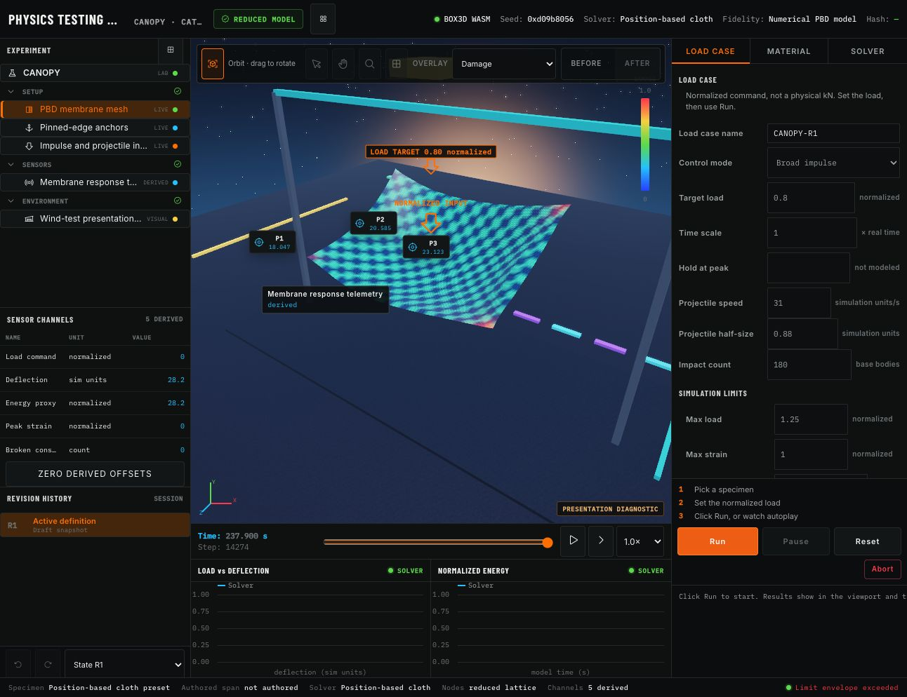
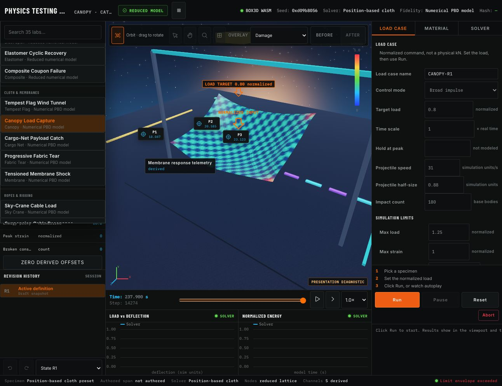
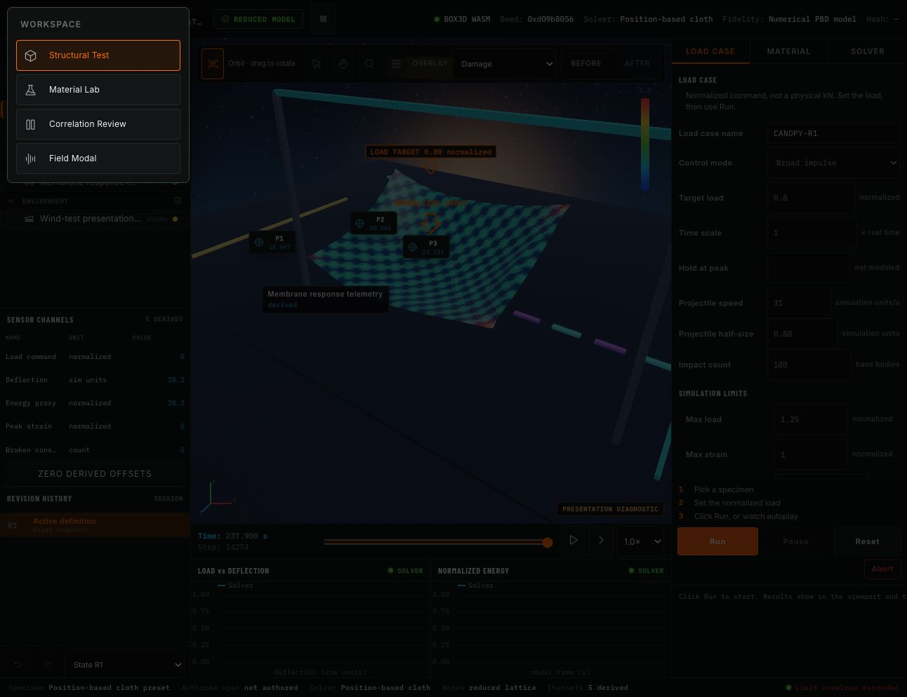
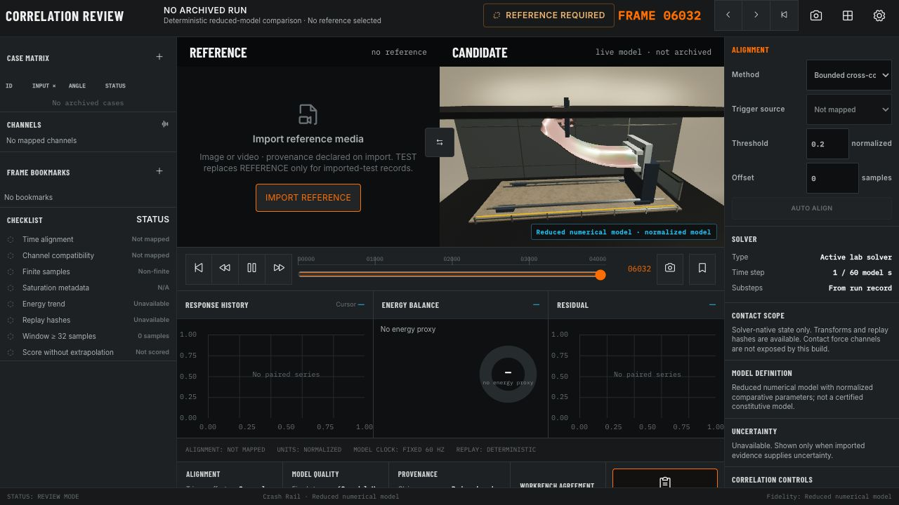

# Box3D workbench review and realism direction

Date: 2026-09-08  
Source checkout: `dfedd9f` on `main`  
Status: review and three ImageGen directions complete; UI and 3D implementation awaits the user's visual selection.

## Outcome

Make BOX3D a compelling engineering experiment tool: readable controls, an uncluttered live 3D viewport, believable physical assemblies, and results whose origin is clear. Generated images are design targets. They are not implemented scenes, recorded results, or validation of real-world engineering accuracy.

## Captured review

The current run was paused for inspection and resumed afterward. No run was aborted, reset, or deleted. A separate temporary browser tab was used to inspect the comparison empty state and was closed afterward.

### 1. Inspect the canopy — functional simulation, weak physical readability

- Live WebGPU canvas, a working pause/run control, visible solver identity, normalized inputs, and derived-channel labels are useful foundations.
- The default scene uses a star field, saturated cyan/purple fixtures, and a strongly patterned membrane. Materials and setting do not communicate a believable test facility.
- The cloth's four pinned corners need visibly connected clevises, posts, base plates and mounting details, each driven by the actual anchor positions.
- The large input overlay, duplicate response markers, toolbar and legend consume valuable scene area.
- The panel labels are tiny; titles, apparatus names and field values truncate. Structural CSS uses a 12px base with multiple smaller secondary styles.
- Disabled select, pan, zoom, mesh and before/after controls suggest capabilities the viewport cannot presently deliver.
- At capture the run had passed its configured duration while 'Abort on limit' was off. The limit warning and the elapsed-time ruler need a clearer relationship. The image shows a model time beyond the visible timeline range.
- The two plots appear empty in the captured state while live values are shown. This warrants an explicit empty/history state and verification of the recorder-to-chart connection; the screenshot alone does not identify the underlying cause.

### 2. Browse the catalogue — working search and grouping, weak discoverability

- The current registry and browser both contain 35 curated labs. Older prose and startup chrome still refer to 31.
- The narrow text-only catalogue overlays the experiment tree and leaves little room for explaining what each lab demonstrates.
- Add visually grounded previews, clear family grouping and a concise solver/experiment summary. Retain all existing lab and scene IDs.
- A selected lab should show its specimen and load path immediately, with the camera framing the entire apparatus.

### 3. Change workspace — state protection is present, explanation is easy to miss

- Comparison and field views are hidden behind an icon-only workspace menu.
- Selecting Correlation Review from the paused canopy returned to Structural Test.
- Source inspection confirms this is an intentional active-run guard in `src/main.ts:2819`, not proof the comparison view is absent.
- The guard retains solver state and asks for completion or abort, but that explanation was not prominent in the rendered screen. Show an inline message beside the attempted navigation and offer a clear return to the active run. Preserve the run.
- Primary navigation should expose the core experiment / compare / evidence path without making users hunt through icons.

### 4. Inspect comparison — honest missing-data state, excessive empty machinery

- A separate direct route loaded Correlation Review with no archived cases or selected reference.
- It correctly avoids inventing correlation scores and uncertainty data.
- Empty case tables, channels, bookmarks, three charts, disabled alignment controls, metadata and checklists all compete with the actual next action.
- Lead with 'Choose a reference and a candidate' and reveal the analysis controls after data exists.
- 'Finite samples: Non-finite' appears with zero samples. Treat absence of samples as 'Not checked'; reserve failure wording for a performed check.
- The material scene already has some workshop geometry. Its lighting, fixture detail, camera and presentation still differ greatly from the physical rendering ambition in the earlier concept.

## Accessibility scope

Observed: small and low-contrast secondary labels, clipped strings, icon-only navigation, many disabled targets, high information density and persistent motion. Focus outlines exist in the CSS; native controls and accessible labels are present in the tree.

Not established: full keyboard traversal, screen-reader experience, measured WCAG contrast, mobile reflow, or compliance. These require direct verification after implementation. No accessibility compliance is claimed.

## ImageGen directions

Each image was generated independently using the built-in image generation tool. Prompts used the captured current app; the first two also received the previous structural concept as a material-realism reference. Output order below matches the displayed images in this conversation.

1. [Generated direction 1](option-1-precision-studio.png)
2. [Generated direction 2](option-2-research-atelier.png)
3. [Generated direction 3](option-3-field-observatory.png)

Requested frame: 1440 × 1024. Actual saved images: 1487 × 1058. Originals were retained and copied without modification. [Full prompts and provenance](imagegen-prompts.json).

Concept labels, chart traces, mock dimensions, model settings, profile avatars and version/date text are illustrative. They must be replaced by actual runtime values and supported capabilities during implementation. In particular, a photoreal fixture does not establish a calibrated, finite-element, contact-force, or aerodynamic solver.

## Implementation contract after selection

1. Implement the chosen visual hierarchy in the existing TypeScript workbench. Use Inter for interface text and IBM Plex Mono for data; increase routine labels to readable product sizes.
2. Keep the actual WebGPU canvas and numerical solvers. Never use a generated scene image as a replacement for interactive geometry.
3. Make material appearance and analysis overlays explicit modes; default to natural materials. Connect overlays only to the available numerical fields.
4. Author scene-specific, geometrically grounded fixtures and environments using the [35-lab rebuild matrix](SCENE-REBUILD-PLAN.md).
5. Make only active controls prominent. Preserve run lifecycle, stable seeds, lab IDs, evidence provenance and normalized units.
6. Make the scene the main work surface, keep run/pause/reset reachable, use one clear response tray, and progressively disclose advanced controls.
7. Verify desktop, tablet and phone layouts; compare at least a second orbit angle for each reconstructed scene; check startup, switching, controls, recording and comparison states.
8. Run the relevant typecheck, unit tests, WebGPU validation and production build. Report separately which scenes were authored, rendered, compared to the reference, and accepted.

## Work preserved

The original shader edit remains in the named Git stash from the preceding pull task. This design pass has not changed source or package files. Its artifacts live only under `docs/design/realism-20260908/`.
