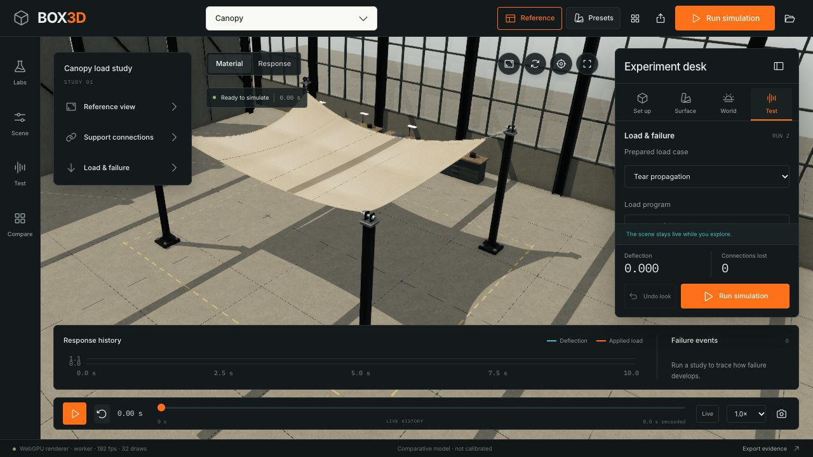

# Collision review and studio startup — 2026-09-30

The studio is running on [localhost:4401](http://127.0.0.1:4401/?studio=canopy&theme=precision&finish=canopy-linen&light=daylight&recipe=canopy-tear&camera=hero&quality=ultra&surroundings=hall-concrete&layout=reference) and is left open, reset and ready to simulate. TypeScript checking, all 122 focused collision tests and the Vite bundle build passed. Live canopy Run/Pause/Reset was verified through 29.41 seconds using WebGPU and a worker, with no captured console warnings or errors.

| Severity | Location | Finding |
| --- | --- | --- |
| P1 | [convex-contact.ts:428](../../../src/engine/convex-contact.ts#L428), also line 509 | Secondary collision discovery depends on `externalForces` being set. An impact can redirect another body through a thin wall without that callback. The end-state penetration and unresolved-CCD counters can both remain zero. |

The independent reviewer and owner both reproduced the finding. Two boxes with half extents 0.05 m start at x=-0.1 and x=0, with a fixed thin wall at x=0.15. The first box moves at 60 m/s. After one 1/120-second step, the second box reaches x=0.4125 with the callback unset. Adding an otherwise empty callback catches the wall and leaves the box near x=-0.102. This is a current-runtime finding, separate from the historical glass accuracy experiment. The full reproducible source and both outputs are in [review.json](review.json).

This pass is read-only for production source. The finding remains open. When implementing it, make collision rediscovery independent of authored-force staging and add a regression for the callback-free chain.

The build avoided copying the existing 142 MB public asset folder, which the local preview served in place. Existing chunk-size and Node loader deprecation warnings remain. This focused review does not establish correctness of every engine change, every study, fault recovery under injected failures, calibration or performance improvement.

The preview server is intentionally retained at 127.0.0.1:4401 for the user. Temporary build output and run logs were removed after recording hashes and results. The compact evidence set is listed in [EVIDENCE.json](EVIDENCE.json). The separate [glass experiment checkpoint](README.md) retains its verified best candidate without applying it to production.
